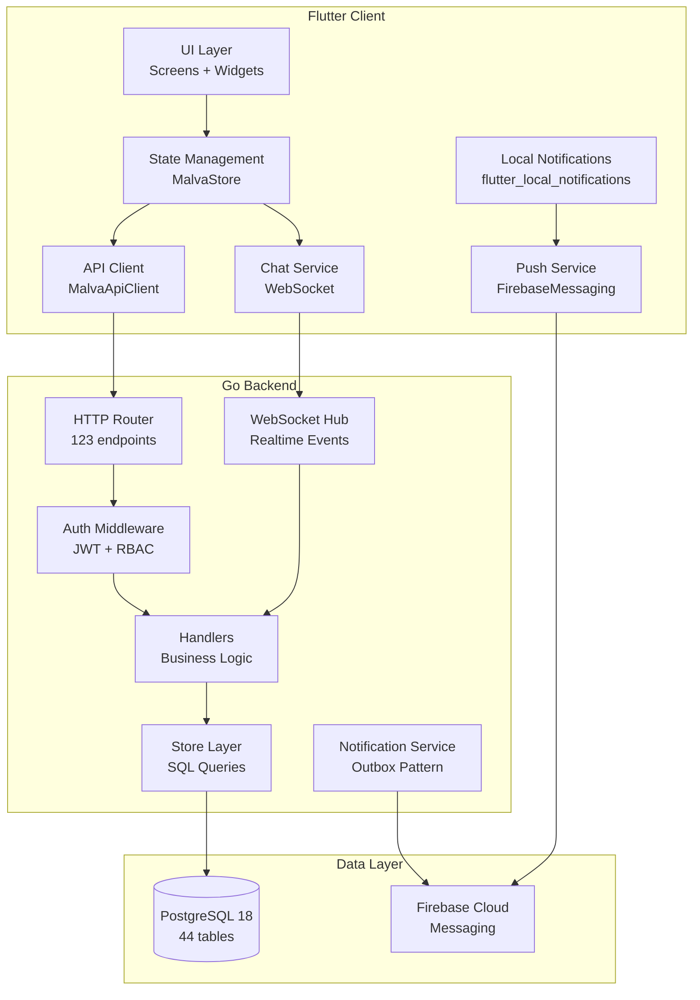
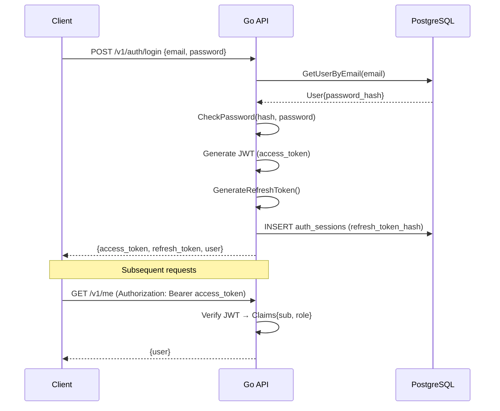
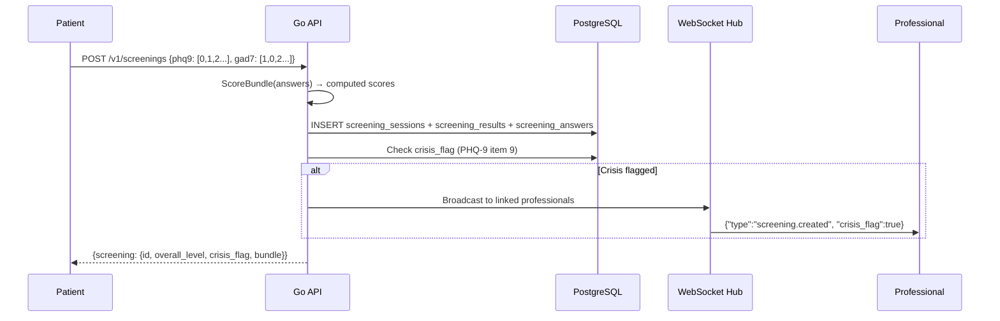
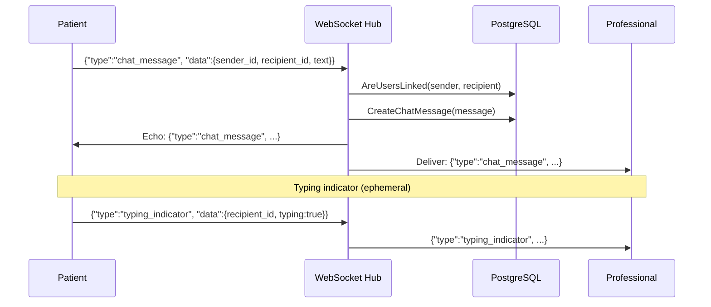
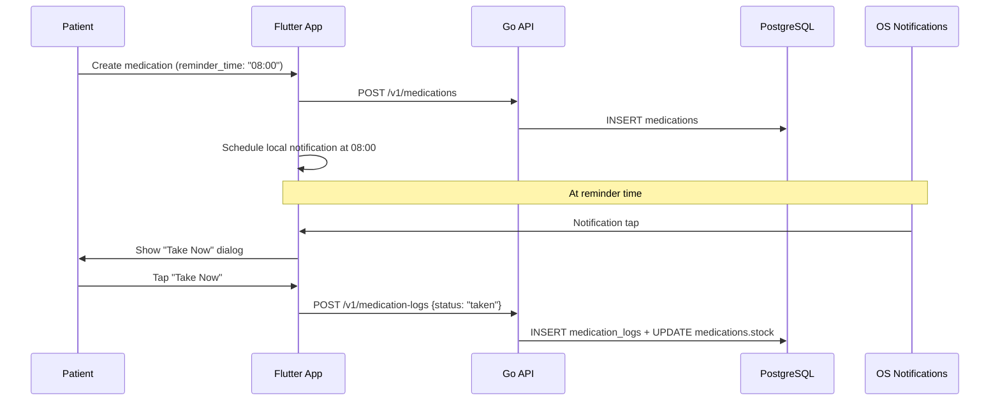
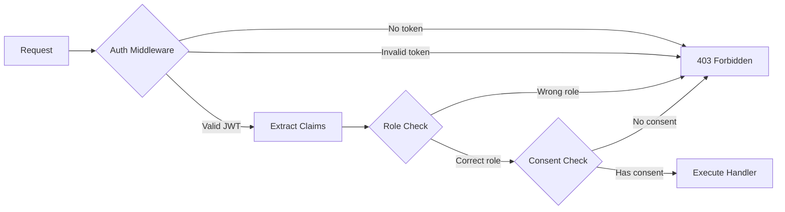
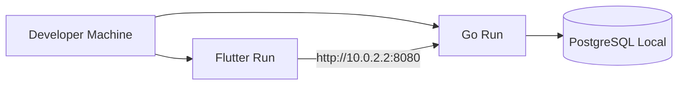
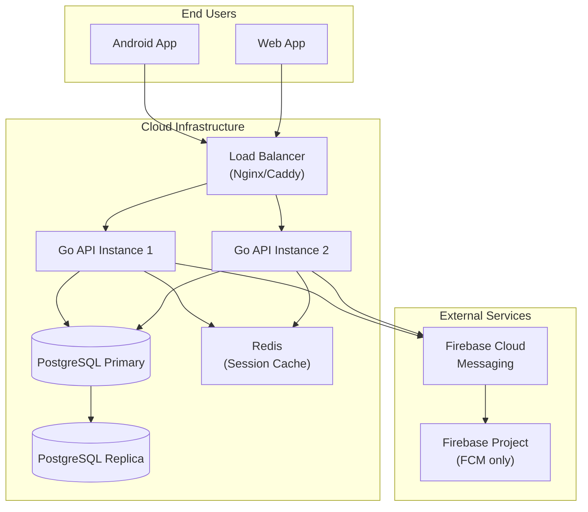

# System Architecture

### Entitlement ulasan — 9 November 2026

Store menurunkan satu hak dari sesi satu kali selesai atau paket yang seluruh
kuota pembeliannya selesai/no-show (minimal satu completed). Saldo merged tetap
digabung, namun ID setiap pembelian tetap satu unit ulasan. Store membagi sesi
pemakai kuota (urut scheduled_at,id) ke rentang pembelian awal lalu renewal (urut
merged_at,created_at,id); kuota awal diperoleh dengan mengurangi kuota child dari
total target. Ownership/kuota/rantai merged ambigu ditolak konservatif. Hak
renewal menunggu seluruh prefix pertemuan pemakai kuota terminal; konfirmasi
absensi yang masih mungkin mengembalikan kredit tidak boleh menggeser hak terpakai.
Tidak ada
perubahan aktivasi/pembayaran/ledger. Pembacaan pasien tidak dibatasi
feed riwayat. Pengiriman mengambil advisory lock pasangan pasien/profesional,
membaca ulang hak di transaksi, lalu INSERT dengan ID unit; unique partial index
migrasi 035 membatasi satu ulasan per sesi/paket. POST lama tanpa ID memakai hak
tertua. Ulasan legacy tetap tanpa tautan dan memblokir unit selesai pada/sebelum
ulasan lama terakhir pasangan secara konservatif, tanpa backfill dugaan.
Flutter membaca endpoint hak, memeriksa identitas akun setelah async dan menjaga
satu dialog/unit/account selama sesi aplikasi. Tidak ada push baru.

### Konsistensi transaksi dan notifikasi — 5 November 2026

Pembelian pending memakai penguncian database dan relasi `care_packages.booking_id` agar retry, resume dan aktivasi membayar paket yang tepat. Pembayaran diverifikasi server terhadap Midtrans termasuk nominal; callback, polling dan lifecycle resume hanya memicu rekonsiliasi. Tidak ada tabel atau kolom baru untuk perbaikan ini.

Outbox memeriksa ulang event, peran penerima dan pasangan/waktu sesi chat sebelum FCM; job terminal tidak diambil lagi. Flutter menyaring foreground dan menjadwalkan goals/obat hanya untuk akun pasien aktif dengan pemeriksaan generasi setelah operasi async. Android notification tag stabil mencegah penumpukan pengiriman ulang.

Therapy Record memakai endpoint share dan read yang ada; chat hanya membawa referensi, bukan seluruh jawaban privat. CF dan kategori skor instrumen tetap terpisah; bobot model tidak dinyatakan sebagai probabilitas klinis.

**Malva Mental Health App**

| Field | Value |
|---|---|
| Version | 2.1 (Production) |
| Date | 2026-07-30 |
| Last Updated | 2026-10-29 |

> **Pembaruan 2026-10-29 (terverifikasi di kode):** 123 endpoint aktif
> (`go run ./cmd/apidoc -check`), 44 tabel (migrasi 001–020), pembayaran via
> gateway Midtrans + webhook bertanda tangan (mode `simulation` tetap
> tersedia untuk dev), blast SOS WhatsApp via Fonnte
> (`POST /v1/crisis-alerts`), serta skala asesmen baku DASS-21 0–3 / WHO-5 0–5
> dengan penanda `scale_version: 2` pada submission baru.

---

## 1. Architecture Overview



## 2. Component Architecture

### 2.1 Flutter Client

```
lib/
├── main.dart                          # Entry point + Firebase init
├── firebase_options.dart              # FlutterFire config (generated)
├── src/
│   ├── malva_app.dart                 # App root, session management
│   ├── models.dart                    # Data models (MoodValue, ScreeningBundle, etc.)
│   ├── theme.dart                     # Material 3 theme (light + dark)
│   ├── assessment_engine.dart         # PHQ-9/GAD-7 scoring engine
│   ├── store/
│   │   └── malva_store.dart           # Central state management + secure storage
│   ├── services/
│   │   ├── malva_api_client.dart      # HTTP client (all API calls)
│   │   ├── chat_service.dart          # WebSocket chat
│   │   ├── push_notification_service.dart  # FCM + local notifications
│   │   ├── medication_reminder_service.dart # Local notification scheduling
│   │   └── dashboard_sync_service.dart     # 30s polling sync
│   └── screens/
│       ├── login_screen.dart          # Auth (register + login)
│       ├── patient_shell.dart         # Patient bottom nav container
│       ├── home_screen.dart           # Patient home
│       ├── mood_screen.dart           # Mood tracking
│       ├── medication_screen.dart     # Medication management
│       ├── diary_screen.dart          # Diary
│       ├── assessment_screen.dart     # PHQ-9 + GAD-7
│       ├── chat_screen.dart           # Real-time chat
│       ├── more_screen.dart           # Settings + extras
│       ├── professional_dashboard_screen.dart  # Professional dashboard
│       └── consent_management_screen.dart      # Privacy controls
```

### 2.2 Go Backend

```
backend/
├── cmd/api/main.go                    # Entry point
├── internal/
│   ├── config/config.go               # Environment config
│   ├── auth/
│   │   ├── password.go                # bcrypt hash/check
│   │   ├── jwt.go                     # JWT create/verify
│   │   ├── refresh.go                 # Refresh token gen/hash
│   │   └── role.go                    # Role normalization
│   ├── store/store.go                 # PostgreSQL data access
│   ├── server/server.go               # HTTP handlers + routing
│   ├── realtime/hub.go                # WebSocket hub
│   └── screening/engine.go            # PHQ-9/GAD-7 scoring
├── migrations/
│   ├── 001_initial.sql                # Core tables
│   ├── 002_auth_sessions.sql          # Auth sessions
│   ├── 003_professional_features.sql  # Notes, follow-ups, reviews
│   ├── 004_notification_center.sql    # Notifications + outbox
│   └── 005_chat.sql                   # Chat messages
├── .env                               # Local environment
├── Dockerfile                         # Container build
└── docker-compose.yml                 # Local dev stack
```

## 3. Data Flow

### 3.1 Authentication Flow



### 3.2 Screening Flow



### 3.3 Chat Flow



### 3.4 Medication Reminder Flow



## 4. Security Architecture

### 4.1 Authentication & Authorization



### 4.2 Data Access Matrix

| Resource | Patient Owner | Linked Professional | Unlinked Professional |
|---|---|---|---|
| Own screening | ✅ Read/Write | ✅ Read (with consent) | ❌ |
| Own mood | ✅ Read/Write | ✅ Read (with consent) | ❌ |
| Own diary | ✅ Read/Write | ✅ Read (with consent) | ❌ |
| Own medication | ✅ Read/Write | ✅ Read (with consent) | ❌ |
| Professional notes | ❌ (unless shared) | ✅ Read/Write (own) | ❌ |
| Follow-up messages | ✅ Read | ✅ Read/Write | ❌ |
| Chat messages | ✅ Read/Write | ✅ Read/Write | ❌ |
| Audit logs | ✅ Read (own) | ✅ Read (linked) | ❌ |
| Consent settings | ✅ Read/Write | ❌ | ❌ |

### 4.3 Security Controls

| Control | Implementation |
|---|---|
| Password hashing | bcrypt with cost factor 10 |
| JWT signing | HS256 with configurable secret |
| Token rotation | Refresh token rotated on every use |
| Session expiry | Access: 24h, Refresh: 30 days |
| Rate limiting | 20 req/min per IP on auth endpoints |
| Input validation | Server-side validation on all inputs |
| SQL injection | Parameterized queries (no string concatenation) |
| CORS | Configurable allowed origins |
| Audit logging | All data mutations logged with actor/patient |
| Data minimization | Only necessary data in responses |

## 5. Deployment Architecture

### 5.1 Development



### 5.2 Production



### 5.3 Container Configuration

```dockerfile
# Dockerfile
FROM golang:1.22-alpine AS builder
WORKDIR /app
COPY go.mod go.sum ./
RUN go mod download
COPY . .
RUN CGO_ENABLED=0 go build -o api ./cmd/api

FROM alpine:3.19
RUN apk --no-cache add ca-certificates
COPY --from=builder /app/api /api
EXPOSE 8080
CMD ["/api"]
```

## 6. Monitoring & Observability

| Metric | Tool | Alert Threshold |
|---|---|---|
| API response time | Application logs | > 500ms (p95) |
| Error rate | Application logs | > 1% of requests |
| WebSocket connections | Hub metrics | > 1000 concurrent |
| Database connections | PostgreSQL stats | > 80% pool usage |
| Memory usage | Container stats | > 80% of limit |
| Disk usage | PostgreSQL | > 80% of volume |
| FCM delivery rate | Firebase console | < 95% delivery |

## 7. Scalability Considerations

| Component | Current | Scaling Strategy |
|---|---|---|
| Flutter Client | Single build | Platform-specific builds (Android/iOS/Web) |
| Go API | Single instance | Horizontal scaling (multiple containers) |
| PostgreSQL | Single instance | Read replicas + connection pooling |
| WebSocket | Single hub | Sticky sessions or Redis pub/sub |
| FCM | Stateless | Managed by Firebase (auto-scales) |

## 8. Disaster Recovery

| Scenario | Recovery Strategy | RTO | RPO |
|---|---|---|---|
| API crash | Auto-restart (systemd/docker) | < 30s | 0 |
| Database crash | Restore from backup + WAL replay | < 1 hour | < 5 min |
| Full outage | Re-deploy from container image | < 2 hours | < 1 hour |
| Data corruption | Point-in-time recovery | < 4 hours | < 1 hour |

## 9. Migration Strategy

| Version | Changes | Downtime |
|---|---|---|
| 001_initial | Core tables (users, screenings, mood, diary, medication) | Zero |
| 002_auth_sessions | Refresh token sessions | Zero |
| 003_professional_features | Notes, follow-ups, screening reviews | Zero |
| 004_notification_center | Notifications + outbox | Zero |
| 005_chat | Chat messages | Zero |

All migrations use `CREATE TABLE IF NOT EXISTS` and are idempotent.

## Sinkronisasi rilis mobile/backend 0.1.3

Backend produksi sebelumnya tertinggal dari source APK, sehingga kontrak booking paket dan `attended` tidak cocok. Deploy harus memakai source teruji yang sama dengan APK. Pada cutover, hentikan worker, retire antrean transport sampai cutoff WIB memakai `backend/deploy/scripts/retire_notification_backlog.sql`, lalu jalankan worker baru. Riwayat notifikasi tidak dihapus.

FCM memakai payload data-only. Receiver Flutter menerima pesan, sedangkan service Android mencegah SDK merender payload notification legacy secara otomatis. Validator foreground/background memeriksa akun dan scope sesi ongoing menggunakan jam server. Native cleanup hanya menyentuh posted notifications/delegate; alarm goals/obat tetap ditangani scheduler yang sudah ada.
# Session/clinical chat data flow (2026-11-06)

Session rows serialize attendance and terminal transitions with FOR UPDATE. Additive migration 032 preserves the legacy marker and introduces independent participant attendance. The active query uses scheduled status and an exclusive end. Flutter uses ServerClock, exact expiry timers and bounded permission revalidation. Patient responses omit professional private notes; partial detail updates preserve omitted values.

REST and WebSocket share store-level professional card validation. Authenticated private upload validates file bytes, atomically publishes immutable files in UploadDir + '-chat-private', then stores an attachment chat message. Only persisted message participants can read bytes; the directory is never served by the public uploads route. A crash before DB persistence can leave an inaccessible orphan file; retain it during uncertain writes to protect concurrent retries. Include this private directory in protected backups; any future orphan cleanup must cross-check persisted attachment IDs.

Stable per-intent client UUIDs derive deterministic message IDs; goal creation uses a bounded idempotency header. Derived homework snapshots are preserved on replay. Clinical mutations broadcast clinical_data_changed to the authenticated patient connection; the existing PatientShell realtime client refreshes Medication Check-in and open clinical views, with reconnect/resume recovery. Existing local medication reminder scheduling follows store updates. No additional OS push kind is introduced.

Midtrans authenticated HTTPS GET status validates exact order binding and existing amount/fraud rules; webhook ingestion retains its independent SHA512 signature verification.

## Skrining WHO-5 dan assessment terpadu (7 November 2026)

Symptoms Assessment dimulai dengan WHO-5 lengkap. Persentase = raw x4;
raw <13 atau satu item 0-1 mengaktifkan PHQ-9/GAD-7, sedangkan hasil baik
berakhir pada kesimpulan WHO tanpa membuat skor PHQ/GAD. DASS-21 tetap manual.
Katalog pasien dan detail profesional menyatukan empat instrumen. Skor baku
terpisah dari CF dukungan model yang belum dikalibrasi klinis. Kontrak data,
consent dan berbagi tetap memakai mekanisme sebelumnya.
Rincian: [scoring dan Forward Chaining](SCREENING_SCORING.md).


## Koreksi klien mobile/web — 8 November 2026

Penawaran initial screening dibatasi pada respons pendaftaran baru: Google memakai
status HTTP 201 yang sudah ada; login 200/restore tidak mengaktifkan gerbang.
SecureStore per akun menyimpan keputusan sebelum presentasi. Formulir/hasil tetap
terpisah sehingga abandon bukan hasil tes. Profil GET/PATCH `/v1/me` menjaga
identitas dan rotasi kredensial; respons akun lama ditolak.

Ekspor memakai `ExportService.buildPdf/sharePdf` (pdf + font Roboto terbundel),
MultiPage dan FileExporter.saveBytes untuk unduhan web/share sheet mobile.
Blok teks dibatasi karakter dan baris eksplisit; penjagaan akun diperiksa kembali
sebelum share. Ekspor screening meminta kedua sumber berhasil dan menyebut batas
feed. Tidak ada perubahan endpoint/DTO/skema. Share profesional tetap memakai
endpoint/otorisasi paket, tautan dan izin server yang sudah ada.

Reschedule memisahkan tipe sesi dari nilai picker sebelum serialisasi WIB.
SOS memakai queryParameters pada URI; status pending dipoll maksimal 60 detik,
berhenti saat terminal/error/dispose/ganti akun. Gateway accepted dipisahkan dari
delivery receipt; backend belum memiliki alur callback receipt otomatis.

## Konsistensi sesi dan rutinitas resep — 10 November 2026

Handler booking/jadwal menormalisasi permintaan baru pasien ke Video dan memakai
slot minimal satu jam. Store pembuatan/reschedule memakai advisory transaction
lock per profesional dan pemeriksaan irisan interval. Reschedule memperbarui
sesi serta booking asal dalam transaksi yang sama; pengingat/kehadiran direset.
Pembaruan Calendar dilakukan setelah commit sehingga konflik DB tidak mengubah
event kalender, sedangkan kegagalan Calendar tetap menghasilkan warning.
Ketersediaan memakai query batch untuk seluruh kandidat beserta durasinya.

`PatientDataAccessActive` memisahkan hak record dari jendela chat/Meet. Preferensi
consent tetap tersimpan per pasangan; tanpa paket aktif, record hanya tersedia
sepanjang durasi sesi scheduled. Paket aktif mempertahankan akses antarsesi
sesuai consent. Share worksheet dan pembacaan profesional memakai batas yang
sama. Lampiran profesional menggunakan verifikasi, relasi dan jendela sesi;
riwayat pesan yang telah dikirim tetap berotorisasi sebagai riwayat percakapan.
Pembatalan satu kali dan migrasi 038 menonaktifkan link hanya setelah tidak ada
sesi/paket/pembelian lain yang memberi hak.

Wizard resep mengirim rutinitas terstruktur, bentuk/dosis/satuan serta stok.
Transaksi `CreateEPrescription` menulis resep, item dan obat pasien bersama,
sehingga kegagalan salah satunya membatalkan seluruh penerbitan. Rutinitas JSON
dipakai kembali untuk checklist dan notifikasi lokal, bukan diparsing dari label
frekuensi. Migrasi 037 menambah penyimpanan jadwal/stok tanpa menghapus reminder
legacy. Migrasi 036–040 telah diterapkan di produksi dan diverifikasi ulang pada rilis
0.1.15+16. Durasi/default ketiga tabel telah60menit; jam mulai legacy dipertahankan.

CRUD resep memakai satu transaksi untuk header, item, medication dan audit.
Update mengunci header milik penulis; ID item/medication tetap, item yang tidak
dikirim menjadi inactive. Stok medication diperbarui dengan delta snapshot
pasokan sehingga checklist paralel tidak hilang. `remaining_stock` dibaca dari
medication; `current_stock` item tetap snapshot pasokan. Draft tidak mengaktifkan
obat dan hanya terlihat oleh penulis; soft-delete mempertahankan log klinis.
QR acak dirotasi setiap simpan dan draft/delete membatalkan tanda tangan/token
sebelumnya. Migrasi 039 menambah diagnosis/item active, sedangkan backfill 040
terpisah hanya memakai bukti pasokan positif yang belum diedit/dikonsumsi.
Detail, daftar dan verifikasi QR membaca header/item dalam snapshot repeatable
read, sehingga revisi draft paralel tidak bercampur dengan header issued lama.

### Tambah Resep dan interval bulan kalender

Wizard profesional mengikuti empat tahap referensi; stok hanya pada pengingat isi ulang. Fleksibel melewati pengingat konsumsi, memakai explicit times[] dan interval0; tidak ada fallback jam. Key opsional schedule.interval_months0–12 mendukung injeksi tiapXbulan, eksklusif dengan interval jam/hari. Scheduler menghitung bulan kalender dari tanggal anchor asli, clamp ke hari terakhir bulan pendek lalu kembali ke tanggal anchor pada bulan berikutnya. Pengingat berkala mengantre60kejadian dan diisi ulang saat refresh/resume. Tidak ada migrasi tabel/kolom.

Pada batas respons HTTP, jadwal bulanan mengembalikan times[] dan monthly_times berisi jam aktual; reminder_time obat dikosongkan. Klien lama tidak akan menurunkan jadwal menjadi harian setelah refresh. Klien baru memulihkan monthly_times hanya untuk interval bulan positif dan mengirim request kanonis memakai times. Penyimpanan serta audit tetap kanonis tanpa proyeksi; edit bulanan membutuhkan versi baru. Seluruh delapan respons obat/resep termasuk verifikasi QR memakai proyeksi yang sama.
