# Database Schema

**Malva Mental Health App — PostgreSQL**

| Field | Value |
|---|---|
| Database | PostgreSQL 18 |
| Total Tables | 44 |
| Total Indexes | 41 (CREATE INDEX eksplisit; belum termasuk UNIQUE/PK inline) |
| Custom Types | 4 enums |
| Migrasi | 001–020 (`backend/migrations/`) |

---

## 1. Entity Relationship Diagram

```mermaid
erDiagram
    users ||--o| patient_profiles : "has profile"
    users ||--o| professional_profiles : "has profile"
    users ||--o{ auth_sessions : "has sessions"
    users ||--o{ device_tokens : "has tokens"
    users ||--o{ notifications : "receives"
    users ||--o{ audit_logs : "generates"

    users ||--o{ patient_professional_links : "patient links"
    users ||--o{ patient_professional_links : "professional links"

    users ||--o{ screening_sessions : "submits"
    screening_sessions ||--o{ screening_results : "contains"
    screening_results ||--o{ screening_answers : "has answers"
    screening_sessions ||--o{ screening_reviews : "reviewed by"

    users ||--o{ mood_checkins : "tracks mood"
    users ||--o{ diary_entries : "writes diary"
    users ||--o{ medications : "takes medication"
    medications ||--o{ medication_logs : "logged"
    users ||--o{ professional_notes : "creates notes"
    users ||--o{ follow_up_messages : "sends/receives"
    users ||--o{ chat_messages : "sends messages"

    users ||--o{ patient_data_consents : "consent settings"

    notifications ||--o{ notification_outbox : "queued"

    %% --- Relasi domain komersial, safety, dan terapi (migrasi 006–017) ---
    %% Relasi logis; tabel care_* dan beberapa tabel 012/013 sengaja tanpa FK
    %% fisik (lihat catatan di §3.21/3.22 dan §3.30).
    users ||--o{ bookings : "books"
    bookings ||--o| payments : "paid by"
    payments ||--o{ payment_events : "gateway events"
    payments ||--o{ earnings : "generates"
    care_sessions ||--o| earnings : "recognized at completion"
    users ||--o{ care_packages : "buys"
    care_packages ||--o{ care_sessions : "contains"
    care_packages ||--o{ care_refunds : "refunded"
    care_sessions ||--o{ care_refunds : "cancellation credit"
    users ||--o{ emergency_contacts : "has"
    users ||--o{ crisis_incidents : "triggers"
    crisis_incidents ||--o{ sos_blast_log : "blasts"
    users ||--o{ goals : "sets"
    goals ||--o{ habit_logs : "logged"
    users ||--o{ therapy_submissions : "submits"
    users ||--o{ doctor_reviews : "writes"
    users ||--o{ e_prescriptions : "issues"
    e_prescriptions ||--o{ e_prescription_items : "contains"
    users ||--o| professional_credentials : "has"
    users ||--o{ professional_schedules : "sets"
    users ||--o{ professional_pricing : "prices"
    users ||--o{ service_packages : "offers"
    users ||--o| google_oauth_tokens : "authorizes"

    users {
        uuid id PK
        text email UK
        text password_hash
        user_role role
        text display_name
        timestamptz created_at
        timestamptz updated_at
        timestamptz disabled_at
    }

    patient_profiles {
        uuid user_id PK
        date date_of_birth
        text diagnosis_summary
        jsonb emergency_contact
        boolean privacy_mode
    }

    professional_profiles {
        uuid user_id PK
        text professional_id UK
        text license_label
        text organization
    }

    patient_professional_links {
        uuid patient_id PK
        uuid professional_id PK
        text status
        timestamptz created_at
    }

    screening_sessions {
        uuid id PK
        uuid patient_id FK
        uuid submitted_by FK
        text source
        boolean is_initial
        text rule_version
        risk_level overall_level
        boolean crisis_flag
        timestamptz created_at
    }

    screening_results {
        uuid id PK
        uuid session_id FK
        assessment_type type
        integer score
        integer max_score
        risk_level level
        text summary
        boolean crisis_flag
    }

    screening_answers {
        uuid id PK
        uuid result_id FK
        text question_id
        integer score
        integer position
    }

    screening_reviews {
        uuid id PK
        uuid screening_session_id FK
        uuid patient_id FK
        uuid professional_id FK
        text status
        text note
        timestamptz created_at
        timestamptz updated_at
    }

    auth_sessions {
        uuid id PK
        uuid user_id FK
        text refresh_token_hash UK
        text user_agent
        text ip_address
        timestamptz created_at
        timestamptz last_used_at
        timestamptz expires_at
        timestamptz revoked_at
    }

    professional_notes {
        uuid id PK
        uuid patient_id FK
        uuid professional_id FK
        text body
        text visibility
        timestamptz created_at
        timestamptz updated_at
        timestamptz archived_at
    }

    follow_up_messages {
        uuid id PK
        uuid patient_id FK
        uuid professional_id FK
        text body
        text status
        timestamptz created_at
        timestamptz updated_at
        timestamptz read_at
        timestamptz archived_at
    }

    mood_checkins {
        uuid id PK
        uuid patient_id FK
        text mood
        numeric sleep_hours
        integer energy
        integer anxiety
        integer irritability
        text note
        timestamptz occurred_at
        timestamptz created_at
    }

    diary_entries {
        uuid id PK
        uuid patient_id FK
        text mood
        text title
        text note
        boolean shared_with_professionals
        text professional_feedback
        timestamptz occurred_at
        timestamptz created_at
        timestamptz updated_at
        timestamptz deleted_at
    }

    medications {
        uuid id PK
        uuid patient_id FK
        text name
        text dosage
        text form
        text reminder_time
        text relation_to_meal
        integer current_stock
        integer alert_below
        text source
        boolean active
        timestamptz created_at
        timestamptz updated_at
    }

    medication_logs {
        uuid id PK
        uuid patient_id FK
        uuid medication_id FK
        text medication_name
        text status
        timestamptz taken_at
        timestamptz created_at
    }

    patient_data_consents {
        uuid patient_id PK
        uuid professional_id PK
        boolean share_screenings
        boolean share_mood_diary
        boolean share_medications
        boolean share_timeline
        timestamptz updated_at
    }

    device_tokens {
        uuid id PK
        uuid user_id FK
        text platform
        text token UK
        boolean enabled
        timestamptz last_seen_at
        timestamptz created_at
    }

    notifications {
        uuid id PK
        uuid user_id FK
        text type
        text title
        text body
        jsonb data
        boolean privacy_sensitive
        notification_status status
        timestamptz created_at
        timestamptz sent_at
        timestamptz read_at
    }

    notification_outbox {
        uuid id PK
        uuid notification_id FK
        text provider
        integer attempts
        timestamptz next_attempt_at
        timestamptz locked_at
        timestamptz delivered_at
        text last_error
        timestamptz created_at
    }

    audit_logs {
        uuid id PK
        uuid actor_id FK
        uuid patient_id FK
        text action
        text entity_type
        uuid entity_id
        jsonb metadata
        timestamptz created_at
    }

    chat_messages {
        text id PK
        uuid patient_id FK
        uuid professional_id FK
        uuid sender_id FK
        text sender_name
        text text
        timestamptz created_at
    }
```



## 2. Custom Types (Enums)

```sql
CREATE TYPE user_role AS ENUM ('patient', 'professional', 'admin');
CREATE TYPE risk_level AS ENUM ('minimal', 'mild', 'moderate', 'severe', 'crisis');
CREATE TYPE assessment_type AS ENUM ('phq9', 'gad7');
CREATE TYPE notification_status AS ENUM ('pending', 'sent', 'failed');
```

## 3. Table Details

### 3.1 users

| Column | Type | Constraints | Description |
|---|---|---|---|
| `id` | uuid | PK, DEFAULT gen_random_uuid() | Unique user identifier |
| `email` | text | NOT NULL, UNIQUE | Login email |
| `password_hash` | text | NOT NULL | bcrypt hashed password |
| `role` | user_role | NOT NULL | patient / professional / admin |
| `display_name` | text | NOT NULL | Display name |
| `phone` | text | NULLABLE (006; varchar(32) di 011) | Nomor telepon |
| `date_of_birth` | date | NULLABLE (011) | Tanggal lahir (semua role) |
| `gender` | varchar(20) | NULLABLE (011) | Jenis kelamin |
| `phone_verified_at` | timestamptz | NULLABLE (006) | Waktu verifikasi nomor |
| `sso_provider` | varchar(50) | NULLABLE (006), UNIQUE bersama `sso_id` | Penyedia SSO (mis. google) |
| `sso_id` | varchar(255) | NULLABLE (006) | ID subjek di penyedia SSO |
| `created_at` | timestamptz | NOT NULL, DEFAULT now() | Account creation time |
| `updated_at` | timestamptz | NOT NULL, DEFAULT now() | Last profile update |
| `disabled_at` | timestamptz | NULLABLE | Account deactivation time |

### 3.2 patient_profiles

| Column | Type | Constraints | Description |
|---|---|---|---|
| `user_id` | uuid | PK, FK → users(id) CASCADE | Patient user ID |
| `date_of_birth` | date | NULLABLE | Date of birth |
| `diagnosis_summary` | text | NULLABLE | Clinical diagnosis summary |
| `emergency_contact` | jsonb | NOT NULL, DEFAULT '{}' | Emergency contact info |
| `privacy_mode` | boolean | NOT NULL, DEFAULT true | Lock screen privacy mode |

### 3.3 professional_profiles

| Column | Type | Constraints | Description |
|---|---|---|---|
| `user_id` | uuid | PK, FK → users(id) CASCADE | Professional user ID |
| `professional_id` | text | NOT NULL, UNIQUE | License / registration number |
| `license_label` | text | NULLABLE | License type (e.g., Sp.KJ.) |
| `organization` | text | NULLABLE | Workplace organization |

### 3.4 patient_professional_links

| Column | Type | Constraints | Description |
|---|---|---|---|
| `patient_id` | uuid | PK, FK → users(id) CASCADE | Patient user ID |
| `professional_id` | uuid | PK, FK → users(id) CASCADE | Professional user ID |
| `status` | text | NOT NULL, DEFAULT 'active' | active / inactive |
| `created_at` | timestamptz | NOT NULL, DEFAULT now() | Link creation time |

**Index:** `patient_professional_links_professional_idx` ON (professional_id, created_at DESC) WHERE status = 'active'

### 3.5 screening_sessions

| Column | Type | Constraints | Description |
|---|---|---|---|
| `id` | uuid | PK, DEFAULT gen_random_uuid() | Screening session ID |
| `patient_id` | uuid | NOT NULL, FK → users(id) CASCADE | Patient being screened |
| `submitted_by` | uuid | NOT NULL, FK → users(id) | Submitter (patient or professional) |
| `source` | text | NOT NULL, DEFAULT 'patient_app' | Submission source |
| `is_initial` | boolean | NOT NULL, DEFAULT false | Initial screening flag |
| `rule_version` | text | NOT NULL | Scoring rule version |
| `overall_level` | risk_level | NOT NULL | Overall risk level |
| `crisis_flag` | boolean | NOT NULL, DEFAULT false | Crisis detection flag |
| `created_at` | timestamptz | NOT NULL, DEFAULT now() | Submission time |

**Index:** `screening_sessions_patient_created_idx` ON (patient_id, created_at DESC)

### 3.6 screening_results

| Column | Type | Constraints | Description |
|---|---|---|---|
| `id` | uuid | PK, DEFAULT gen_random_uuid() | Result ID |
| `session_id` | uuid | NOT NULL, FK → screening_sessions(id) CASCADE | Parent session |
| `type` | assessment_type | NOT NULL | phq9 / gad7 |
| `score` | integer | NOT NULL, CHECK (score >= 0) | Computed score |
| `max_score` | integer | NOT NULL, CHECK (max_score > 0) | Maximum possible score |
| `level` | risk_level | NOT NULL | Risk level classification |
| `summary` | text | NOT NULL | Human-readable summary |
| `crisis_flag` | boolean | NOT NULL, DEFAULT false | Crisis detection |
| `cf` | double precision | NOT NULL, DEFAULT 0.0 (009) | Certainty Factor hasil reasoning server |
| `rule_trace` | text | NOT NULL, DEFAULT '' (009) | Jejak rule yang menembak (audit) |

**Constraint:** UNIQUE (session_id, type)

### 3.7 screening_answers

| Column | Type | Constraints | Description |
|---|---|---|---|
| `id` | uuid | PK, DEFAULT gen_random_uuid() | Answer ID |
| `result_id` | uuid | NOT NULL, FK → screening_results(id) CASCADE | Parent result |
| `question_id` | text | NOT NULL | Question identifier |
| `score` | integer | NOT NULL, CHECK (score BETWEEN 0 AND 3) | Answer score (0-3) |
| `position` | integer | NOT NULL, CHECK (position > 0) | Question position |

**Constraint:** UNIQUE (result_id, question_id)

### 3.8 screening_reviews

| Column | Type | Constraints | Description |
|---|---|---|---|
| `id` | uuid | PK, DEFAULT gen_random_uuid() | Review ID |
| `screening_session_id` | uuid | NOT NULL, FK → screening_sessions(id) CASCADE | Screened session |
| `patient_id` | uuid | NOT NULL, FK → users(id) CASCADE | Patient |
| `professional_id` | uuid | NOT NULL, FK → users(id) CASCADE | Reviewing professional |
| `status` | text | NOT NULL, DEFAULT 'reviewed' | reviewed / needs_follow_up / closed |
| `note` | text | NOT NULL, DEFAULT '' | Review note |
| `created_at` | timestamptz | NOT NULL, DEFAULT now() | Review creation time |
| `updated_at` | timestamptz | NOT NULL, DEFAULT now() | Last update time |

**Constraint:** UNIQUE (screening_session_id, professional_id)

### 3.9 auth_sessions

| Column | Type | Constraints | Description |
|---|---|---|---|
| `id` | uuid | PK, DEFAULT gen_random_uuid() | Session ID |
| `user_id` | uuid | NOT NULL, FK → users(id) CASCADE | User |
| `refresh_token_hash` | text | NOT NULL, UNIQUE | Hashed refresh token |
| `user_agent` | text | NULLABLE | Client user agent |
| `ip_address` | text | NULLABLE | Client IP address |
| `created_at` | timestamptz | NOT NULL, DEFAULT now() | Session creation |
| `last_used_at` | timestamptz | NULLABLE | Last token use |
| `expires_at` | timestamptz | NOT NULL | Expiration time |
| `revoked_at` | timestamptz | NULLABLE | Revocation time |

**Index:** `auth_sessions_user_active_idx` ON (user_id, expires_at DESC) WHERE revoked_at IS NULL

### 3.10 professional_notes

| Column | Type | Constraints | Description |
|---|---|---|---|
| `id` | uuid | PK, DEFAULT gen_random_uuid() | Note ID |
| `patient_id` | uuid | NOT NULL, FK → users(id) CASCADE | Patient |
| `professional_id` | uuid | NOT NULL, FK → users(id) CASCADE | Authoring professional |
| `body` | text | NOT NULL | Note content |
| `visibility` | text | NOT NULL, DEFAULT 'private' | private / shared_with_patient |
| `created_at` | timestamptz | NOT NULL, DEFAULT now() | Creation time |
| `updated_at` | timestamptz | NOT NULL, DEFAULT now() | Last update time |
| `archived_at` | timestamptz | NULLABLE | Soft delete time |

**Index:** `professional_notes_patient_idx` ON (patient_id, updated_at DESC) WHERE archived_at IS NULL

### 3.11 follow_up_messages

| Column | Type | Constraints | Description |
|---|---|---|---|
| `id` | uuid | PK, DEFAULT gen_random_uuid() | Message ID |
| `patient_id` | uuid | NOT NULL, FK → users(id) CASCADE | Recipient patient |
| `professional_id` | uuid | NOT NULL, FK → users(id) CASCADE | Sender professional |
| `body` | text | NOT NULL | Message content |
| `status` | text | NOT NULL, DEFAULT 'sent' | draft / sent |
| `created_at` | timestamptz | NOT NULL, DEFAULT now() | Creation time |
| `updated_at` | timestamptz | NOT NULL, DEFAULT now() | Last update time |
| `read_at` | timestamptz | NULLABLE | Patient read time |
| `archived_at` | timestamptz | NULLABLE | Soft delete time |

**Index:** `follow_up_messages_patient_idx` ON (patient_id, created_at DESC) WHERE archived_at IS NULL

### 3.12 mood_checkins

| Column | Type | Constraints | Description |
|---|---|---|---|
| `id` | uuid | PK, DEFAULT gen_random_uuid() | Check-in ID |
| `patient_id` | uuid | NOT NULL, FK → users(id) CASCADE | Patient |
| `mood` | text | NOT NULL | great / good / okay / sad / awful |
| `sleep_hours` | numeric(4,1) | NOT NULL, DEFAULT 0 | Hours of sleep |
| `energy` | integer | NOT NULL, CHECK (0-10) | Energy level |
| `anxiety` | integer | NOT NULL, CHECK (0-10) | Anxiety level |
| `irritability` | integer | NOT NULL, CHECK (0-10) | Irritability level |
| `note` | text | NOT NULL, DEFAULT '' | Free-form note |
| `occurred_at` | timestamptz | NOT NULL, DEFAULT now() | When the mood was recorded |
| `created_at` | timestamptz | NOT NULL, DEFAULT now() | Record creation time |

**Index:** `mood_checkins_patient_idx` ON (patient_id, occurred_at DESC)

### 3.13 diary_entries

| Column | Type | Constraints | Description |
|---|---|---|---|
| `id` | uuid | PK, DEFAULT gen_random_uuid() | Entry ID |
| `patient_id` | uuid | NOT NULL, FK → users(id) CASCADE | Patient |
| `mood` | text | NOT NULL | great / good / okay / sad / awful |
| `title` | text | NOT NULL | Entry title (max 160 chars) |
| `note` | text | NOT NULL | Entry content (max 6000 chars) |
| `shared_with_professionals` | boolean | NOT NULL, DEFAULT true | Visibility to professionals |
| `professional_feedback` | text | NULLABLE | Professional's feedback |
| `occurred_at` | timestamptz | NOT NULL, DEFAULT now() | When the diary was written |
| `created_at` | timestamptz | NOT NULL, DEFAULT now() | Record creation time |
| `updated_at` | timestamptz | NOT NULL, DEFAULT now() | Last update time |
| `deleted_at` | timestamptz | NULLABLE | Soft delete time |

**Index:** `diary_entries_patient_idx` ON (patient_id, occurred_at DESC) WHERE deleted_at IS NULL

### 3.14 medications

| Column | Type | Constraints | Description |
|---|---|---|---|
| `id` | uuid | PK, DEFAULT gen_random_uuid() | Medication ID |
| `patient_id` | uuid | NOT NULL, FK → users(id) CASCADE | Patient |
| `name` | text | NOT NULL | Medication name |
| `dosage` | text | NOT NULL | Dosage (e.g., "50mg") |
| `form` | text | NOT NULL | Form (tablet, syrup, etc.) |
| `reminder_time` | text | NOT NULL, DEFAULT '' | Reminder time (HH:MM) |
| `relation_to_meal` | text | NOT NULL, DEFAULT '' | before_meal / after_meal / with_meal |
| `current_stock` | integer | NOT NULL, DEFAULT 0, CHECK (>= 0) | Current pill/unit count |
| `alert_below` | integer | NOT NULL, DEFAULT 0, CHECK (>= 0) | Low-stock threshold |
| `source` | text | NOT NULL, DEFAULT 'patient' | patient / professional |
| `active` | boolean | NOT NULL, DEFAULT true | Active flag |
| `created_at` | timestamptz | NOT NULL, DEFAULT now() | Creation time |
| `updated_at` | timestamptz | NOT NULL, DEFAULT now() | Last update time |

**Index:** `medications_patient_idx` ON (patient_id, updated_at DESC) WHERE active

### 3.15 medication_logs

| Column | Type | Constraints | Description |
|---|---|---|---|
| `id` | uuid | PK, DEFAULT gen_random_uuid() | Log ID |
| `patient_id` | uuid | NOT NULL, FK → users(id) CASCADE | Patient |
| `medication_id` | uuid | FK → medications(id) SET NULL | Medication reference |
| `medication_name` | text | NOT NULL | Medication name (denormalized) |
| `status` | text | NOT NULL, DEFAULT 'taken' | taken / missed / skipped / partial (015) |
| `taken_at` | timestamptz | NOT NULL, DEFAULT now() | When the dose was taken |
| `created_at` | timestamptz | NOT NULL, DEFAULT now() | Record creation time |

**Index:** `medication_logs_patient_idx` ON (patient_id, taken_at DESC)

### 3.16 patient_data_consents

| Column | Type | Constraints | Description |
|---|---|---|---|
| `patient_id` | uuid | PK, FK → users(id) CASCADE | Patient |
| `professional_id` | uuid | PK, FK → users(id) CASCADE | Professional |
| `share_screenings` | boolean | NOT NULL, DEFAULT true | Share screening data |
| `share_mood_diary` | boolean | NOT NULL, DEFAULT true | Share mood & diary data |
| `share_medications` | boolean | NOT NULL, DEFAULT true | Share medication data |
| `share_timeline` | boolean | NOT NULL, DEFAULT true | Share timeline data |
| `updated_at` | timestamptz | NOT NULL, DEFAULT now() | Last update time |

### 3.17 device_tokens

| Column | Type | Constraints | Description |
|---|---|---|---|
| `id` | uuid | PK, DEFAULT gen_random_uuid() | Token ID |
| `user_id` | uuid | NOT NULL, FK → users(id) CASCADE | User |
| `platform` | text | NOT NULL | android / ios / web |
| `token` | text | NOT NULL, UNIQUE | FCM device token |
| `enabled` | boolean | NOT NULL, DEFAULT true | Active flag |
| `last_seen_at` | timestamptz | NOT NULL, DEFAULT now() | Last token use |
| `created_at` | timestamptz | NOT NULL, DEFAULT now() | Registration time |

**Index:** `device_tokens_user_enabled_idx` ON (user_id) WHERE enabled

### 3.18 notifications

| Column | Type | Constraints | Description |
|---|---|---|---|
| `id` | uuid | PK, DEFAULT gen_random_uuid() | Notification ID |
| `user_id` | uuid | NOT NULL, FK → users(id) CASCADE | Recipient |
| `type` | text | NOT NULL | Notification type |
| `title` | text | NOT NULL | Notification title |
| `body` | text | NOT NULL | Notification body |
| `data` | jsonb | NOT NULL, DEFAULT '{}' | Additional data |
| `privacy_sensitive` | boolean | NOT NULL, DEFAULT true | Hide on lock screen |
| `status` | notification_status | NOT NULL, DEFAULT 'pending' | pending / sent / failed |
| `created_at` | timestamptz | NOT NULL, DEFAULT now() | Creation time |
| `sent_at` | timestamptz | NULLABLE | Delivery time |
| `read_at` | timestamptz | NULLABLE | Read time |

**Index:** `notifications_user_created_idx` ON (user_id, created_at DESC)
**Index:** `notifications_user_unread_idx` ON (user_id, created_at DESC) WHERE read_at IS NULL

### 3.19 notification_outbox

| Column | Type | Constraints | Description |
|---|---|---|---|
| `id` | uuid | PK, DEFAULT gen_random_uuid() | Outbox ID |
| `notification_id` | uuid | NOT NULL, FK → notifications(id) CASCADE | Parent notification |
| `provider` | text | NOT NULL, DEFAULT 'fcm' | Delivery provider |
| `attempts` | integer | NOT NULL, DEFAULT 0 | Delivery attempt count |
| `next_attempt_at` | timestamptz | NOT NULL, DEFAULT now() | Next retry time |
| `locked_at` | timestamptz | NULLABLE | Processing lock |
| `delivered_at` | timestamptz | NULLABLE | Delivery confirmation |
| `last_error` | text | NULLABLE | Last error message |
| `created_at` | timestamptz | NOT NULL, DEFAULT now() | Creation time |

**Index:** `notification_outbox_ready_idx` ON (next_attempt_at) WHERE delivered_at IS NULL

### 3.20 audit_logs

| Column | Type | Constraints | Description |
|---|---|---|---|
| `id` | uuid | PK, DEFAULT gen_random_uuid() | Log ID |
| `actor_id` | uuid | FK → users(id) | Actor (who performed the action) |
| `patient_id` | uuid | FK → users(id) | Patient whose data was accessed |
| `action` | text | NOT NULL | Action description |
| `entity_type` | text | NOT NULL | Entity type (screening, mood, etc.) |
| `entity_id` | uuid | NULLABLE | Entity ID |
| `metadata` | jsonb | NOT NULL, DEFAULT '{}' | Additional metadata |
| `created_at` | timestamptz | NOT NULL, DEFAULT now() | Action time |

**Index:** `audit_logs_patient_created_idx` ON (patient_id, created_at DESC)

### 3.21 care_packages (migrasi 012 — pengganti continuous_support 7 hari)

1 paket = 4 sesi / 42 hari sejak pembayaran. Sisa hangus setelah expired.
Pasien no-show = kuota terpakai. Profesional batal = kredit kembali.
Tanpa FOREIGN KEY (aplikasi jalan sebagai `malva_app` tanpa hak REFERENCES);
integritas ditegakkan di application layer.

| Column | Type | Constraints | Description |
|---|---|---|---|
| `id` | uuid | PK, DEFAULT gen_random_uuid() | Package ID |
| `patient_id` | uuid | NOT NULL (tanpa FK) | Pembeli paket |
| `professional_id` | uuid | NOT NULL (tanpa FK) | Profesional tujuan |
| `booking_id` | uuid | UNIQUE NULLABLE (tanpa FK) | Booking pembayaran aktivasi |
| `total_sessions` | integer | DEFAULT 4 | Selalu 4 |
| `validity_days` | integer | DEFAULT 42 | Selalu 42 (6 minggu) |
| `price` | bigint | DEFAULT 0 | Harga paket saat dibeli |
| `status` | text | pending_payment/active/expired/completed/cancelled | Status paket |
| `starts_at` | timestamptz | DEFAULT now() | Mulai berlaku |
| `expires_at` | timestamptz | NOT NULL | starts_at + 42 hari |
| `refunded_amount` | bigint | NOT NULL, DEFAULT 0 (013) | Akumulasi refund paket |
| `created_at` / `updated_at` | timestamptz | DEFAULT now() | Audit |

### 3.22 care_sessions (migrasi 012)

Sesi terjadwal dari paket (`package_id`) atau quick consult (`booking_id`).
Status pemakan kuota: scheduled, completed, no_show.

| Column | Type | Constraints | Description |
|---|---|---|---|
| `id` | uuid | PK | Session ID |
| `package_id` | uuid | NULLABLE (tanpa FK) | Paket induk (null = quick) |
| `booking_id` | uuid | NULLABLE (tanpa FK) | Booking asal (quick/paket) |
| `patient_id` / `professional_id` | uuid | NOT NULL (tanpa FK) | Peserta |
| `session_type` | text | chat/video | Media sesi |
| `scheduled_at` | timestamptz | NOT NULL | Jadwal (WIB saat input) |
| `duration_minutes` | integer | 10-180 | = durasi slot jadwal pro |
| `status` | text | pending_payment/scheduled/completed/no_show/cancelled_by_professional/cancelled_by_patient/expired_unpaid | Status |
| `meeting_url` | text | DEFAULT '' | Link meeting video |
| `summary_for_patient` | text | DEFAULT '' | Ringkasan sesi (ganti follow-up) |
| `private_note` | text | DEFAULT '' | Catatan privat pro |
| `cancel_reason` / `cancelled_by` | text / uuid | DEFAULT '' / NULL | Alasan & pelaku batal |
| `reschedule_count` | integer | DEFAULT 0 | Jumlah reschedule |
| `attended_marked_at` | timestamptz | NULLABLE | Kapan kehadiran ditandai |
| `google_event_id` | text | NOT NULL, DEFAULT '' (017) | Event Google Calendar terkait sesi video |
| `reminder_sent_at` | timestamptz | NULLABLE (018) | Kapan pengingat sesi dikirim (idempoten sweeper) |
| `meeting_link_created_at` | timestamptz | NULLABLE (018) | Kapan link Meet dibuat/di-generate ulang |

**Index:** `care_sessions_slot_uidx` UNIQUE (professional_id, scheduled_at)
WHERE status IN ('scheduled','pending_payment') — anti double-book.

### 3.23 professional_pricing (migrasi 012)

Tarif milik profesional (diatur via PUT /v1/professional/pricing).
Fallback baca: service_packages lama bila baris belum ada.

| Column | Type | Constraints | Description |
|---|---|---|---|
| `professional_id` | uuid | PK (tanpa FK) | Profesional |
| `quick_chat_price` / `quick_video_price` / `package_price` | bigint | >= 0 | Tarif (0 = belum diatur) |

### 3.24 professional_time_off (migrasi 012)

| Column | Type | Constraints | Description |
|---|---|---|---|
| `id` | uuid | PK | ID |
| `professional_id` | uuid | NOT NULL (tanpa FK) | Profesional |
| `off_date` | date | NOT NULL, UNIQUE(professional_id, off_date) | Hari libur |
| `reason` | text | DEFAULT '' | Alasan |

### 3.25 chat_messages

| Column | Type | Constraints | Description |
|---|---|---|---|
| `id` | text | PK | Message ID (client-generated) |
| `patient_id` | uuid | NOT NULL, FK → users(id) | Patient in conversation |
| `professional_id` | uuid | NOT NULL, FK → users(id) | Professional in conversation |
| `sender_id` | uuid | NOT NULL, FK → users(id) | Message sender |
| `sender_name` | text | NOT NULL, DEFAULT '' | Sender display name |
| `text` | text | NOT NULL | Message content |
| `kind` | varchar(20) | NOT NULL, DEFAULT 'text' (010) | text / summary / assessment / worksheet / resep / goals / diary |
| `attachment_type` | varchar(20) | NULLABLE (006) | Jenis lampiran |
| `attachment_url` | text | NULLABLE (006) | URL lampiran |
| `attachment_meta` | jsonb | NULLABLE (006) | Metadata lampiran |
| `created_at` | timestamptz | NOT NULL, DEFAULT now() | Send time |

**Index:** `idx_chat_messages_conv` ON (patient_id, professional_id, created_at DESC)

---

### 3.26 bookings (migrasi 006, 010)

Booking pembayaran layanan. `service_type` membedakan quick consult dan paket;
`slot_time` boleh NULL untuk layanan async (010).

| Column | Type | Constraints | Description |
|---|---|---|---|
| `id` | uuid | PK, DEFAULT gen_random_uuid() | Booking ID |
| `patient_id` | uuid | NOT NULL, FK → users(id) CASCADE | Pasien |
| `professional_id` | uuid | NOT NULL, FK → users(id) CASCADE | Profesional |
| `package_id` | uuid | NULLABLE, FK → service_packages(id) | Paket legacy (bila ada) |
| `service_type` | varchar(20) | NOT NULL | quick_consult / quick_consult_video / continuous_support |
| `session_type` | varchar(10) | NOT NULL | chat / video |
| `booking_date` | date | NOT NULL | Tanggal booking |
| `slot_time` | time | NULLABLE (010) | Jam slot; NULL untuk layanan async |
| `duration_minutes` | integer | NOT NULL, DEFAULT 30 | Durasi sesi |
| `price` | bigint | NOT NULL | Harga saat booking |
| `status` | varchar(20) | NOT NULL, DEFAULT 'pending' | pending / paid / cancelled / expired |
| `created_at` | timestamptz | DEFAULT CURRENT_TIMESTAMP | Waktu dibuat |

### 3.27 payments (migrasi 006, 013)

Pembayaran per booking. Sejak 013 menyimpan data gateway (Midtrans Snap).

| Column | Type | Constraints | Description |
|---|---|---|---|
| `id` | uuid | PK, DEFAULT gen_random_uuid() | Payment ID |
| `booking_id` | uuid | NOT NULL, FK → bookings(id) CASCADE | Booking yang dibayar |
| `payment_method` | varchar(20) | NOT NULL | Metode pembayaran |
| `gross_amount` | bigint | NOT NULL | Nilai layanan |
| `service_fee_amount` | bigint | NOT NULL, DEFAULT 2000 | Biaya layanan |
| `platform_fee_pct` | smallint | NOT NULL, DEFAULT 10 | Persentase fee platform |
| `platform_fee_amount` | bigint | NOT NULL | Fee platform (rupiah) |
| `net_amount` | bigint | NOT NULL | Bagian profesional |
| `reference` | varchar(255) | NOT NULL, UNIQUE | Nomor referensi / order_id gateway |
| `external_id` | varchar(255) | NULLABLE | ID transaksi gateway |
| `status` | varchar(20) | NOT NULL, DEFAULT 'pending' | pending / paid / expired / failed |
| `paid_at` | timestamptz | NULLABLE | Waktu lunas |
| `expires_at` | timestamptz | NULLABLE | Batas bayar |
| `gateway` | text | NOT NULL, DEFAULT '' (013) | midtrans / kosong (simulasi) |
| `snap_token` | text | NOT NULL, DEFAULT '' (013) | Token Snap |
| `redirect_url` | text | NOT NULL, DEFAULT '' (013) | URL redirect pembayaran |
| `created_at` | timestamptz | DEFAULT CURRENT_TIMESTAMP | Waktu dibuat |

### 3.28 payment_events (migrasi 013)

Log event webhook gateway untuk idempotensi replay.

| Column | Type | Constraints | Description |
|---|---|---|---|
| `id` | uuid | PK, DEFAULT gen_random_uuid() | Event ID |
| `gateway` | text | NOT NULL, DEFAULT 'midtrans' | Penyedia gateway |
| `external_id` | text | NOT NULL | order_id gateway (= `payments.reference`) |
| `event_type` | text | NOT NULL, DEFAULT '' | transaction_status |
| `signature` | text | NOT NULL, DEFAULT '' | Signature yang diterima |
| `gross_amount` | bigint | NOT NULL, DEFAULT 0 | Nilai transaksi |
| `raw_payload` | jsonb | NOT NULL, DEFAULT '{}' | Payload mentah |
| `status` | text | NOT NULL, DEFAULT 'received' | received / processed / ignored / rejected |
| `payment_id` | uuid | NULLABLE | Payment terkait |
| `booking_id` | uuid | NULLABLE | Booking terkait |
| `processed_at` | timestamptz | NULLABLE | Waktu diproses |
| `created_at` | timestamptz | DEFAULT now() | Waktu diterima |

**Index:** `payment_events_idem_uidx` UNIQUE (gateway, external_id, event_type) — anti replay.

### 3.29 earnings (migrasi 006, 016)

Pendapatan profesional. Sejak 016 diakui saat SESI SELESAI dan menunjuk `session_id`
(unique parsial); baris lama tanpa sesi tetap NULL.

| Column | Type | Constraints | Description |
|---|---|---|---|
| `id` | uuid | PK, DEFAULT gen_random_uuid() | Earning ID |
| `professional_id` | uuid | NOT NULL, FK → users(id) CASCADE | Profesional |
| `payment_id` | uuid | NOT NULL, FK → payments(id) CASCADE | Pembayaran asal |
| `session_id` | uuid | NULLABLE (016) | Sesi yang menyelesaikan pendapatan |
| `gross` | bigint | NOT NULL | Nilai bruto |
| `platform_fee` | bigint | NOT NULL | Fee platform |
| `net` | bigint | NOT NULL | Nilai bersih |
| `payout_status` | varchar(20) | NOT NULL, DEFAULT 'pending' | pending / payout_requested / paid_out |
| `payout_bank` | varchar(50) | NULLABLE | Bank tujuan |
| `payout_account` | varchar(100) | NULLABLE | Nomor rekening |
| `payout_requested_at` | timestamptz | NULLABLE | Waktu request payout |
| `paid_out_at` | timestamptz | NULLABLE | Waktu transfer |
| `created_at` | timestamptz | DEFAULT CURRENT_TIMESTAMP | Waktu dibuat |

**Index:** `earnings_session_unique` UNIQUE (session_id) WHERE session_id IS NOT NULL — 1 sesi = 1 baris.

### 3.30 care_refunds (migrasi 013)

Ledger refund/kredit pembatalan oleh profesional. Idempoten via `idempotency_key`.

| Column | Type | Constraints | Description |
|---|---|---|---|
| `id` | uuid | PK, DEFAULT gen_random_uuid() | Refund ID |
| `package_id` | uuid | NULLABLE (tanpa FK) | Paket terkait |
| `session_id` | uuid | NULLABLE (tanpa FK) | Sesi yang dibatalkan |
| `patient_id` / `professional_id` | uuid | NOT NULL (tanpa FK) | Pihak terkait |
| `amount` | bigint | NOT NULL, DEFAULT 0, CHECK >= 0 | Nilai refund (price / total_sessions) |
| `kind` | text | DEFAULT 'credit', CHECK credit/refund | Kredit kuota atau uang kembali |
| `status` | text | DEFAULT 'recorded', CHECK recorded/processing/paid/failed/cancelled | Status |
| `reason` | text | NOT NULL, DEFAULT '' | Alasan |
| `idempotency_key` | text | NOT NULL, UNIQUE | Kunci idempotensi |
| `external_id` | text | NOT NULL, DEFAULT '' | Ref payout/gateway |
| `created_by` | uuid | NULLABLE | Aktor |
| `created_at` / `updated_at` | timestamptz | DEFAULT now() | Audit |

### 3.31 service_packages (migrasi 006)

Paket harga legacy per profesional (sumber migrasi harga di 012).

| Column | Type | Constraints | Description |
|---|---|---|---|
| `id` | uuid | PK, DEFAULT gen_random_uuid() | Package ID |
| `professional_id` | uuid | NOT NULL, FK → users(id) CASCADE | Profesional |
| `package_sessions` | integer | NOT NULL | Jumlah sesi |
| `package_duration_days` | integer | NOT NULL | Masa berlaku (hari) |
| `price` | bigint | NOT NULL | Harga |
| `label` | varchar(50) | NULLABLE | Label paket |
| `is_active` | boolean | NOT NULL, DEFAULT true | Aktif |

### 3.32 professional_schedules (migrasi 006, 014)

Jadwal mingguan profesional.

| Column | Type | Constraints | Description |
|---|---|---|---|
| `id` | uuid | PK, DEFAULT gen_random_uuid() | Schedule ID |
| `professional_id` | uuid | NOT NULL, FK → users(id) CASCADE | Profesional |
| `day_of_week` | integer | NOT NULL | 1–7 |
| `start_time` / `end_time` | time | NOT NULL | Rentang jam |
| `slot_duration_minutes` | integer | NOT NULL, DEFAULT 30 | Durasi slot |
| `is_active` | boolean | NOT NULL, DEFAULT true | Aktif |
| `created_at` | timestamptz | DEFAULT CURRENT_TIMESTAMP | Waktu dibuat |

**Index:** `professional_schedules_unique_slot` UNIQUE (professional_id, day_of_week, start_time, end_time) — anti duplikat (014).

### 3.33 professional_credentials (migrasi 006)

Kredensial & profil praktik profesional (STR/SIP/SIPP, faskes, foto/video intro).

| Column | Type | Constraints | Description |
|---|---|---|---|
| `id` | uuid | PK, DEFAULT gen_random_uuid() | Credential ID |
| `user_id` | uuid | NOT NULL, UNIQUE, FK → users(id) CASCADE | Profesional |
| `str_number` / `sip_number` / `sipp_number` | varchar(100) | NULLABLE | Nomor izin |
| `specialization` | varchar(100) | NOT NULL | Spesialisasi |
| `sub_specialties` | text[] | NULLABLE | Sub-spesialisasi |
| `hospital_lat` / `hospital_lng` | double precision | NULLABLE | Koordinat faskes |
| `hospital_name` | varchar(255) | NULLABLE | Nama faskes |
| `address_details` | text | NULLABLE | Detail alamat |
| `is_bpjs_supported` | boolean | NOT NULL, DEFAULT false | Dukungan BPJS |
| `photo_intro_url` | varchar(255) | NULLABLE | Foto intro (SVG DiceBear bila kosong) |
| `video_intro_url` | varchar(255) | NULLABLE | Video intro |
| `bio` | text | NULLABLE | Biografi |
| `education` | jsonb | NOT NULL, DEFAULT '[]' | Riwayat pendidikan |
| `verification_status` | varchar(20) | DEFAULT 'PENDING' | PENDING / VERIFIED / REJECTED |
| `rejection_reason` | text | NULLABLE | Alasan penolakan |
| `verified_by` / `verified_at` | uuid / timestamptz | NULLABLE | Verifikator & waktu |
| `document_url` | text | NULLABLE | Dokumen pendukung |
| `legacy_count` / `helpfulness_count` / `review_count` | integer | NOT NULL, DEFAULT 0 | Statistik |
| `years_experience` | integer | NOT NULL, DEFAULT 0 | Pengalaman (tahun) |
| `created_at` | timestamptz | DEFAULT CURRENT_TIMESTAMP | Waktu dibuat |

**Index:** `professional_credentials_user_uidx` UNIQUE (user_id).

### 3.34 doctor_reviews (migrasi 006)

Ulasan pasien atas profesional.

| Column | Type | Constraints | Description |
|---|---|---|---|
| `id` | uuid | PK, DEFAULT gen_random_uuid() | Review ID |
| `professional_id` / `patient_id` | uuid | NOT NULL, FK → users(id) CASCADE | Pihak terkait |
| `booking_id` | uuid | NULLABLE, FK → bookings(id) | Booking asal |
| `helpfulness_percent` | integer | NOT NULL, CHECK 0–100 | Persentase membantu |
| `review_text` | text | NULLABLE | Isi ulasan |
| `helpful` | boolean | NOT NULL, DEFAULT true | Tandai membantu |
| `created_at` | timestamptz | DEFAULT CURRENT_TIMESTAMP | Waktu dibuat |

### 3.35 e_prescriptions (migrasi 006)

Resep elektronik dengan token QR.

| Column | Type | Constraints | Description |
|---|---|---|---|
| `id` | uuid | PK, DEFAULT gen_random_uuid() | Prescription ID |
| `professional_id` / `patient_id` | uuid | NOT NULL, FK → users(id) CASCADE | Pihak terkait |
| `notes` / `instructions` | text | NULLABLE | Catatan & instruksi |
| `signature_data` | jsonb | NULLABLE | Data tanda tangan |
| `qr_token` | varchar(255) | NOT NULL, UNIQUE | Token QR verifikasi |
| `status` | varchar(20) | NOT NULL, DEFAULT 'issued' | issued / dispensed / cancelled |
| `created_at` | timestamptz | DEFAULT CURRENT_TIMESTAMP | Waktu dibuat |

### 3.36 e_prescription_items (migrasi 006)

Item obat dalam resep elektronik.

| Column | Type | Constraints | Description |
|---|---|---|---|
| `id` | uuid | PK, DEFAULT gen_random_uuid() | Item ID |
| `prescription_id` | uuid | NOT NULL, FK → e_prescriptions(id) CASCADE | Resep induk |
| `medication_id` | uuid | NULLABLE (tanpa FK) | Obat terkait |
| `name` | varchar(255) | NOT NULL | Nama obat |
| `form` | varchar(50) | NULLABLE | Bentuk sediaan |
| `dosage` | varchar(100) | NULLABLE | Dosis |
| `frequency` | varchar(50) | NULLABLE | Frekuensi |
| `days` | integer | NOT NULL, DEFAULT 30 | Durasi |
| `units_per_day` | integer | NOT NULL, DEFAULT 1 | Unit per hari |
| `unit` | varchar(20) | NOT NULL, DEFAULT 'tablet' | Satuan |

### 3.37 emergency_contacts (migrasi 006)

Kontak darurat pasien untuk blast SOS.

| Column | Type | Constraints | Description |
|---|---|---|---|
| `id` | uuid | PK, DEFAULT gen_random_uuid() | Contact ID |
| `patient_id` | uuid | NOT NULL, FK → users(id) CASCADE | Pasien |
| `contact_name` | varchar(100) | NOT NULL | Nama kontak |
| `contact_phone` | varchar(20) | NOT NULL | Nomor telepon |
| `relationship` | varchar(50) | NULLABLE | Hubungan |
| `is_default` | boolean | NOT NULL, DEFAULT false | Kontak utama |
| `created_at` | timestamptz | DEFAULT CURRENT_TIMESTAMP | Waktu dibuat |

**Index:** `emergency_contacts_patient_idx` ON (patient_id, is_default).

### 3.38 crisis_incidents (migrasi 006)

Insiden krisis/SOS yang dipicu pasien atau screening.

| Column | Type | Constraints | Description |
|---|---|---|---|
| `id` | uuid | PK, DEFAULT gen_random_uuid() | Incident ID |
| `patient_id` | uuid | NOT NULL, FK → users(id) CASCADE | Pasien |
| `triggered_by` | varchar(20) | NOT NULL | patient / screening / professional |
| `phq9_q9_score` | integer | NULLABLE | Skor item 9 PHQ-9 |
| `latitude` / `longitude` | double precision | NULLABLE | Lokasi saat trigger (dipurge setelah resolve) |
| `status` | varchar(20) | NOT NULL, DEFAULT 'active' | active / resolved |
| `resolution_notes` | text | NULLABLE | Catatan penyelesaian |
| `resolved_by` | uuid | NULLABLE, FK → users(id) | Penyelesai |
| `doctor_notified_at` / `contacts_notified_at` | timestamptz | NULLABLE | Waktu notifikasi |
| `created_at` | timestamptz | DEFAULT CURRENT_TIMESTAMP | Waktu trigger |
| `resolved_at` | timestamptz | NULLABLE | Waktu selesai |

**Index:** `crisis_incidents_patient_idx` ON (patient_id, status, created_at DESC); `crisis_incidents_resolved_idx` ON (status, resolved_at) WHERE status = 'resolved'.

### 3.39 sos_blast_log (migrasi 006)

Log pengiriman blast SOS per kontak (channel WhatsApp via Fonnte).

| Column | Type | Constraints | Description |
|---|---|---|---|
| `id` | uuid | PK, DEFAULT gen_random_uuid() | Log ID |
| `crisis_incident_id` | uuid | NOT NULL, FK → crisis_incidents(id) CASCADE | Insiden |
| `contact_phone` | varchar(20) | NOT NULL | Nomor tujuan |
| `channel` | varchar(10) | NOT NULL | wa / sms |
| `status` | varchar(20) | NOT NULL, DEFAULT 'pending' | pending / sent / failed |
| `message_id` | varchar(255) | NULLABLE | ID pesan gateway |
| `created_at` | timestamptz | DEFAULT CURRENT_TIMESTAMP | Waktu dibuat |
| `delivered_at` | timestamptz | NULLABLE | Waktu terkirim |

### 3.40 goals (migrasi 010)

Target/habit pasien yang tersimpan di server.

| Column | Type | Constraints | Description |
|---|---|---|---|
| `id` | uuid | PK, DEFAULT gen_random_uuid() | Goal ID |
| `patient_id` | uuid | NOT NULL, FK → users(id) CASCADE | Pasien |
| `title` | text | NOT NULL | Judul goal |
| `category` | text | NOT NULL, DEFAULT 'general' | Kategori |
| `target_per_week` | integer | NOT NULL, DEFAULT 3 | Target mingguan |
| `is_active` | boolean | NOT NULL, DEFAULT true | Aktif |
| `sort_order` | integer | NOT NULL, DEFAULT 0 | Urutan tampil |
| `created_at` / `updated_at` | timestamptz | DEFAULT now() | Audit |

**Index:** `goals_patient_idx` ON (patient_id, is_active, sort_order).

### 3.41 habit_logs (migrasi 010)

Log harian per goal (satu baris per goal per tanggal).

| Column | Type | Constraints | Description |
|---|---|---|---|
| `id` | uuid | PK, DEFAULT gen_random_uuid() | Log ID |
| `goal_id` | uuid | NOT NULL, FK → goals(id) CASCADE | Goal induk |
| `patient_id` | uuid | NOT NULL, FK → users(id) CASCADE | Pasien |
| `logged_date` | date | NOT NULL, DEFAULT CURRENT_DATE | Tanggal log |
| `done` | boolean | NOT NULL, DEFAULT true | Selesai |
| `created_at` | timestamptz | DEFAULT now() | Waktu dibuat |

**Constraint:** UNIQUE (goal_id, logged_date). **Index:** `habit_logs_patient_idx` ON (patient_id, logged_date DESC).

### 3.42 therapy_submissions (migrasi 010)

Worksheet terapi & hasil asesmen (DASS-21/WHO-5) yang disimpan/dibagikan pasien.
`answers` menyimpan jawaban mentah; submission baru menyertakan `scale_version: 2`.

| Column | Type | Constraints | Description |
|---|---|---|---|
| `id` | uuid | PK, DEFAULT gen_random_uuid() | Submission ID |
| `patient_id` | uuid | NOT NULL, FK → users(id) CASCADE | Pasien |
| `module_id` | text | NOT NULL | ID modul terapi (dass21, who5, …) |
| `title` | text | NOT NULL, DEFAULT '' | Judul worksheet |
| `answers` | jsonb | NOT NULL, DEFAULT '{}' | Jawaban (termasuk penanda versi skala) |
| `summary` | text | NOT NULL, DEFAULT '' | Ringkasan skor |
| `shared_with_professional_id` | uuid | NULLABLE, FK → users(id) SET NULL | Profesional tujuan |
| `shared_at` | timestamptz | NULLABLE | Waktu dibagikan |
| `created_at` / `updated_at` | timestamptz | DEFAULT now() | Audit |

**Index:** `therapy_submissions_patient_idx` ON (patient_id, created_at DESC).

### 3.43 google_oauth_tokens (migrasi 017)

Refresh token Google OAuth per profesional untuk Google Calendar + Meet.

| Column | Type | Constraints | Description |
|---|---|---|---|
| `user_id` | uuid | PK, FK → users(id) CASCADE | Profesional |
| `refresh_token` | text | NOT NULL | Refresh token |
| `access_token` | text | NOT NULL, DEFAULT '' | Access token terakhir |
| `token_expiry` | timestamptz | NOT NULL, DEFAULT now() | Kedaluwarsa access token |
| `scope` | text | NOT NULL, DEFAULT '' | Scope yang diberikan |
| `updated_at` | timestamptz | NOT NULL, DEFAULT now() | Pembaruan terakhir |

### 3.44 psychological_tests_catalog (migrasi 006)

Katalog tes psikologi berbayar.

| Column | Type | Constraints | Description |
|---|---|---|---|
| `id` | varchar(100) | PK | Slug tes |
| `title` | varchar(255) | NOT NULL | Judul |
| `description` | text | NOT NULL | Deskripsi |
| `disclaimer` | text | NOT NULL | Disclaimer |
| `price` | bigint | NOT NULL, DEFAULT 0 | Harga |
| `banner_image_url` | varchar(255) | NULLABLE | Banner |
| `is_active` | boolean | NOT NULL, DEFAULT true | Aktif |
