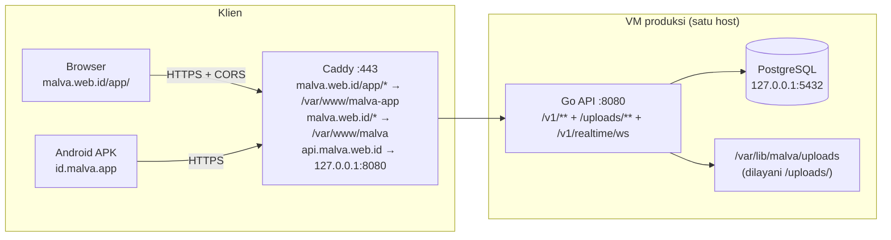
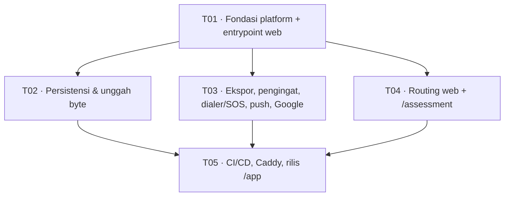

# Malva — Arsitektur Target Web (`malva.web.id/app/`)

| Field | Nilai |
|---|---|
| Status | Desain disetujui-untuk-implementasi (fase 1) |
| Basis kode | `main` @ `2fcfde4` — Flutter 3.44.8, 58 layar, backend Go 123 endpoint |
| Prinsip pengikat | `.agents/AGENTS.md` (8 aturan non-negosiabel) + gate CI |
| Sifat dokumen | Rancangan + daftar tugas. **Bukan** kode fitur |

---

## 0. Ringkasan keputusan

| # | Keputusan | Alasan singkat |
|---|---|---|
| 1 | Satu codebase Flutter, dua entrypoint: `lib/main.dart` (mobile) & `lib/main_web.dart` (web) | Isolasi ditegakkan **compiler**, bukan disiplin manusia |
| 2 | Semua kemampuan khusus platform diakses lewat **port** di `lib/src/platform/contracts/` | UI tidak pernah tahu platform; `kIsWeb` hilang dari kode fitur |
| 3 | Pemilihan implementasi lewat **conditional import** (`dart.library.js_interop`) di satu berkas factory | `flutter test` & mobile otomatis dapat impl `io/`; web otomatis dapat `web/`. Tidak ada override manual yang bisa lupa |
| 4 | **Navigator 1.0 tetap dipakai fase 1**, ditambah lapisan sinkronisasi URL (`BrowserHistory` port) | Migrasi 71 `Navigator.push` tanpa nama = risiko regresi mobile tertinggi, manfaatnya nol untuk mobile |
| 5 | Cache: `no-cache` untuk entrypoint, cache panjang hanya untuk `canvaskit/**` + `assets/**` | Flutter web **tidak** memberi hash pada nama berkas; "immutable" untuk `main.dart.js` justru membuat deploy tidak pernah sampai ke pengguna (§7.3) |
| 6 | Web dilayani di **path `/app/`** pada `malva.web.id`, root terpisah `/var/www/malva-app` | Subdomain belum punya A record sehingga sertifikat tidak bisa terbit; rincian opsi subdomain ada di §1.4. Root terpisah tetap wajib: `/var/www/malva` dipakai `rsync --delete` landing — satu salah path = landing hilang |
| 7 | Fitur yang belum aman di web **dimatikan lewat capability flag**, bukan dibiarkan jadi tombol mati | Audit menemukan 7 kelas kegagalan "lolos kompilasi, gagal runtime"; tombol mati = bug senyap |

---

## 1. Topologi



### 1.1 Peran tiap URL

| URL | Root di disk | Isi | Siapa yang deploy |
|---|---|---|---|
| `malva.web.id/app/*` | `/var/www/malva-app` | Build Flutter web (`--base-href=/app/`) | `deploy-app-web.yml` (baru) |
| `malva.web.id/*` (selain `/app`) | `/var/www/malva` | Landing statis — **jangan disentuh** | `deploy-web.yml` (rsync `--delete`) |
| `api.malva.web.id` | — | Go API (`reverse_proxy 127.0.0.1:8080`) | `deploy-backend.yml` |

Dua root terpisah adalah **satu-satunya** isolasi yang mencegah deploy web menghapus landing. Karena aplikasi kini berbagi host dengan landing, urutannya wajib: `handle_path /app/*` **lebih dulu**, lalu `handle` untuk sisa path. Landing tidak mendapat `try_files` (perilaku 404-nya harus tetap seperti sekarang).

### 1.2 Blok Caddy lengkap

Ganti blok `malva.web.id` di `backend/deploy/Caddyfile` menjadi (blok `api.malva.web.id` dan `www` **tidak diubah**):

```caddyfile
malva.web.id {
	encode zstd gzip

	# /app tanpa garis miring → /app/ agar resolusi <base href="/app/"> benar.
	redir /app /app/ 308

	# ── Aplikasi Flutter web ──────────────────────────────────────────────
	# handle_path MEMBUANG prefix /app, sehingga berkas dicari langsung di
	# /var/www/malva-app (cocok dengan --base-href=/app/).
	handle_path /app/* {
		root * /var/www/malva-app

		# ── Entrypoint: wajib revalidasi agar deploy langsung berlaku ──────
		# Flutter TIDAK memberi hash pada main.dart.js / flutter_bootstrap.js,
		# jadi keduanya TIDAK BOLEH immutable: kalau di-cache 1 tahun, deploy
		# berikutnya tidak akan pernah sampai ke pengguna. ETag → 304, murah.
		@entrypoint path / /index.html /main.dart.js /flutter_bootstrap.js /flutter_service_worker.js /manifest.json /version.json /favicon.png
		header @entrypoint Cache-Control "no-cache"

		# ── Aset berat: cache panjang (bukan immutable, lihat §7.3) ───────
		# canvaskit/** hanya berubah saat versi Flutter di-upgrade; assets/**
		# ikut build. 7 hari + revalidasi ETag cukup; service worker menutup sisanya.
		@longcache path /canvaskit/* /assets/* /icons/*
		header @longcache Cache-Control "public, max-age=604800"

		# ── WASM: pastikan MIME benar (Skia/CanvasKit + skwasm) ───────────
		@wasm path *.wasm
		header @wasm Content-Type application/wasm

		# ── Header keamanan (hanya untuk aplikasi, landing tidak diubah) ──
		header {
			Content-Security-Policy "default-src 'self'; script-src 'self' 'wasm-unsafe-eval' https://apis.google.com https://www.gstatic.com https://www.google.com; style-src 'self' 'unsafe-inline'; img-src 'self' data: blob: https://api.malva.web.id https://*.googleusercontent.com; font-src 'self' data: https://fonts.gstatic.com; connect-src 'self' https://api.malva.web.id wss://api.malva.web.id https://*.googleapis.com https://firebaseinstallations.googleapis.com https://fcmregistrations.googleapis.com https://accounts.google.com https://fonts.gstatic.com; frame-src https://accounts.google.com https://*.firebaseapp.com; worker-src 'self' blob:; child-src 'self' blob:; object-src 'none'; base-uri 'self'; form-action 'self'"
			X-Content-Type-Options nosniff
			Referrer-Policy strict-origin-when-cross-origin
			X-Frame-Options DENY
			Permissions-Policy "geolocation=(self), camera=(self), microphone=(self), payment=(self)"
			Strict-Transport-Security "max-age=31536000; includeSubDomains"
		}

		# ── SPA fallback: path tanpa berkas → index.html ──────────────────
		try_files {path} /index.html
		file_server
	}

	# ── Landing statis: perilaku lama dipertahankan apa adanya ────────────
	handle {
		root * /var/www/malva
		file_server
	}
}
```

Catatan CSP yang mudah salah:

- `'wasm-unsafe-eval'` **wajib** — tanpa itu CanvasKit/skwasm gagal init dan layar putih tanpa pesan.
- `worker-src 'self' blob:` **wajib** — Flutter web menjalankan worker dari blob.
- `frame-src https://accounts.google.com` **wajib** untuk Google Identity Services (login Google).
- `connect-src` harus memuat `wss://api.malva.web.id` — chat realtime memakai WebSocket (`server.go:1799-1806`).
- Tanpa `fonts.gstatic.com` di `font-src`, Roboto fallback gagal diam-diam (teks tetap tampil dengan font sistem, tapi ada error console).
- `'self'` di sini berarti `https://malva.web.id`; aset `/app/*` tetap **same-origin**, jadi tidak perlu origin tambahan.

### 1.3 Perubahan backend (konfigurasi saja, tanpa perubahan kode)

| Item | Nilai baru | Berkas |
|---|---|---|
| `MALVA_ALLOWED_ORIGINS` | `https://malva.web.id,https://www.malva.web.id` — **tidak perlu entri baru** | `backend/deploy/env.production.example` |

Karena aplikasi kini berbagi origin dengan landing, `Origin` yang dikirim browser tetap `https://malva.web.id` — sudah ada di daftar. CORS multi-origin + preflight sudah benar (`config.go:68,112-122`, `server.go:2108-2126`). Tidak ada perubahan kode backend fase 1.

### 1.4 Opsi subdomain (belum bisa dipakai — dicatat agar tidak hilang)

Bila kelak pemilik domain membuat **A record** `app.malva.web.id` → `48.193.44.179` (saat ini domain tersebut *non-existent*, dan tidak ada wildcard `*.malva.web.id`, sehingga Caddy tidak bisa menerbitkan sertifikat), aplikasi bisa dipindah ke subdomain tanpa mengubah kode: cukup build ulang dengan `--base-href=/` dan pakai site block terpisah.

```caddyfile
# ALTERNATIF — hanya setelah A record app.malva.web.id ada.
# Butuh perubahan ikutan: --base-href=/ (bukan /app/), MALVA_ALLOWED_ORIGINS
# ditambah https://app.malva.web.id, dan JS origin Google Console diperbarui.
#app.malva.web.id {
#	root * /var/www/malva-app
#	encode zstd gzip
#	@entrypoint path / /index.html /main.dart.js /flutter_bootstrap.js /flutter_service_worker.js /manifest.json /version.json /favicon.png
#	header @entrypoint Cache-Control "no-cache"
#	@longcache path /canvaskit/* /assets/* /icons/*
#	header @longcache Cache-Control "public, max-age=604800"
#	@wasm path *.wasm
#	header @wasm Content-Type application/wasm
#	header { /* CSP + header keamanan sama seperti §1.2 */ }
#	try_files {path} /index.html
#	file_server
#}
```

Karena root disk (`/var/www/malva-app`) dan workflow deploy tetap sama, perpindahan ini hanya menyentuh 3 hal: `--base-href`, origin CORS, dan JS origin Google.

Temuan yang **tidak** diperbaiki sekarang (dicatat agar tidak jadi kejutan):
`Access-Control-Allow-Credentials: true` (`server.go:2117`) tidak berguna karena auth memakai bearer, dan `internal/security/csrf.go:27` tidak pernah dipanggil. Aman untuk fase 1 (token tidak dikirim otomatis oleh browser), tetapi menutup jalan ke opsi cookie httpOnly fase 2 — lihat §8.

---

## 2. Kontrak platform

Tujuan: kode UI/model **tidak pernah** menyebut `kIsWeb`, tidak pernah mengimpor `dart:io`, dan tidak pernah mengimpor plugin yang tidak ada di web.

### 2.1 Berkas kontrak

Sembilan port + dua nilai konfigurasi. `GoogleSignInPort` adalah port ke-9 (ditambahkan saat T03-lanjut, karena web tidak bisa memakai `authenticate()`).

```dart
// lib/src/platform/contracts/ports.dart
import 'dart:typed_data';
import 'package:flutter/foundation.dart' show ValueChanged;
import 'package:flutter/widgets.dart' show Widget;

/// Penyimpanan kunci-nilai rahasia (sesi, token, antrean sync, offset jam).
///
/// Implementasi web saat ini = flutter_secure_storage (localStorage) —
/// keputusan sementara. Menggantinya dengan cookie httpOnly / IndexedDB
/// cukup menambah satu kelas di lib/src/platform/web/ dan satu baris di
/// platform_factory_web.dart; tidak ada berkas UI yang tersentuh.
abstract interface class SecureStore {
  Future<String?> read(String key);
  Future<void> write(String key, String value);
  Future<void> delete(String key);
}

/// Berkas yang sudah dibaca ke memori. Sengaja berbasis byte, bukan path,
/// karena path tidak ada di web (XFile.path = blob URL, bukan berkas nyata).
class PickedFile {
  const PickedFile({
    required this.name,
    required this.bytes,
    required this.mimeType,
  });
  final String name;
  final Uint8List bytes;
  final String mimeType;
  int get size => bytes.length;
}

/// Memilih berkas dari perangkat. Batas ukuran divalidasi di pemanggil.
abstract interface class FilePickerPort {
  /// [kind]: image | video
  Future<PickedFile?> pick(String kind);
}

/// Menyimpan teks sebagai berkas yang bisa diunduh/dibagikan pengguna.
/// io  : temp file + share_plus (lembar bagikan Android)
/// web : Blob + <a download> (unduhan browser)
abstract interface class FileExporter {
  Future<void> saveText({
    required String filename,
    required String content,
    required String mimeType, // 'text/csv' | 'application/json' | 'text/plain'
  });
}

/// Pengingat obat berbasis OS. Di web tidak ada penjadwal lokal.
abstract interface class ReminderScheduler {
  /// false di web → UI wajib menampilkan "kelola pengingat dari aplikasi".
  bool get canScheduleOsReminders;

  Future<void> initialize();
  Future<bool> requestPermissions();
  Future<void> scheduleAll(List<dynamic> medications); // List<Medication>
  Future<void> cancelAll();
  Future<void> showTestNotification();

  /// Pengingat saat aplikasi terbuka. KONTRAK-nya ada, tetapi **web fase 1
  /// tidak mengimplementasikannya**: `NoopReminderScheduler` mengembalikan
  /// `Stream.empty()`. Jangan menampilkan janji "pengingat berbunyi" di web.
  Stream<String> get inAppDueReminders;
}

/// Registrasi token push (FCM).
abstract interface class PushRegistrar {
  /// false di web fase 1 (butuh service worker + VAPID, fase 2).
  bool get canRegister;

  Future<void> initialize({void Function(String route)? onForegroundTap});
  Future<void> requestPermission();
  Future<String?> obtainToken();
  Stream<String> get tokenRefreshes;
  void Function(String route)? onTap;
}

/// Hasil percobaan menelepon.
enum DialOutcome { opened, fallbackShown, failed }

/// Menelepon nomor telepon. Browser tidak punya penangan `tel:` di desktop.
abstract interface class Dialer {
  bool get canDialTel;
  Future<DialOutcome> call(String phoneNumber, {String? displayName});
}

/// Manipulasi riwayat/URL browser. io = no-op (URL tidak relevan).
abstract interface class BrowserHistory {
  String get currentPath;
  void push(String path);
  void replace(String path);
  void attachPopHandler(void Function() onPop);
}

/// Login Google. Dua jalur yang TIDAK bisa disatukan:
/// io  : `authenticate()` (Credential Manager / Play Services)
/// web : WAJIB `renderButton` — `google_sign_in_web` tidak punya
///       `authenticate()` (melempar UnimplementedError) dan UI harus
///       menampilkan tombol resmi Google.
///
/// UI memilih lewat [usesButtonWidget]; tidak ada `kIsWeb` di kode fitur.
abstract interface class GoogleSignInPort {
  /// true di web: UI wajib memanggil [buildButton], bukan [signInIdToken].
  bool get usesButtonWidget;

  /// Jalur io: buka dialog akun Google → ID token (null bila dibatalkan).
  Future<String?> signInIdToken();

  /// Jalur web: tombol resmi Google (renderButton). Token dikirim lewat callback.
  Widget? buildButton({
    required ValueChanged<String> onIdToken,
    required ValueChanged<Object> onError,
  });
}

/// Konfigurasi Google Sign-In per target.
class GoogleClientConfig {
  const GoogleClientConfig({required this.clientId, this.serverClientId});

  /// Web OAuth Client ID — dipakai Android sebagai `serverClientId` dan web
  /// sebagai `clientId`, agar `aud` pada ID token konsisten dengan
  /// `idtoken.Validate` di backend.
  final String clientId;

  /// HANYA untuk io. Di web wajib null: `google_sign_in_web` meng-`assert`
  /// nilainya null, sehingga build web DEBUG gagal bila tetap dikirim
  /// (build release lolos karena assert dibuang — bug senyap).
  final String? serverClientId;
}

/// Kemampuan platform — SATU-SATUNYA cara UI bertanya "bisakah ini?".
class PlatformCapabilities {
  const PlatformCapabilities({
    required this.canScheduleOsReminders,
    required this.canRegisterPush,
    required this.canExportFiles,
    required this.canDialTel,
    required this.canPickFiles,
    required this.canGeolocate,
    required this.canBindGoogleCalendar,
    required this.isWebBuild,
  });

  final bool canScheduleOsReminders;
  final bool canRegisterPush;
  final bool canExportFiles;
  final bool canDialTel;
  final bool canPickFiles;
  final bool canGeolocate;
  final bool canBindGoogleCalendar;
  final bool isWebBuild;
}
```

### 2.2 Pemetaan implementasi

| Port | `lib/src/platform/io/` (mobile/desktop) | `lib/src/platform/web/` | Catatan audit |
|---|---|---|---|
| `SecureStore` | `flutter_secure_storage` (Keystore) | `flutter_secure_storage` (localStorage) | Risiko diterima §8.1 |
| `FilePickerPort` | `image_picker` → `readAsBytes()` | idem (`image_picker` punya impl web) | Sekaligus menghapus `File(picked.path)` |
| `FileExporter` | temp file (`path_provider`) + `share_plus` | `Blob` + `<a download>` | `path_provider` **tidak punya impl web** — ini akar kerusakan ekspor |
| `ReminderScheduler` | `flutter_local_notifications` + `timezone` | `NoopReminderScheduler` (`canScheduleOsReminders: false`, `inAppDueReminders` = `Stream.empty()`) | `zonedSchedule` → `UnsupportedError` di web. **Pengingat in-app TIDAK diimplementasi** — UI wajib menampilkan banner "kelola dari aplikasi", bukan menjanjikan bunyi |
| `PushRegistrar` | `firebase_messaging` native | `NoopPushRegistrar` (`canRegister: false`) | Fase 2: butuh `web/firebase-messaging-sw.js` + VAPID |
| `Dialer` | `url_launcher` `tel:` | `showModalBottomSheet` nomor + salin + `wa.me` | `tel:` no-op di desktop |
| `BrowserHistory` | no-op | `history.pushState` / `SystemNavigator.routeInformationUpdated` | URL browser tidak berubah hari ini |
| Geolokasi | `geolocator` native | `geolocator_web` (HTTPS + izin) | `geolocator_web` sudah ada di lockfile |
| `GoogleSignInPort` | `authenticate()` (Credential Manager) | `renderButton` + `authenticationEvents` → ID token | `google_sign_in_web` **tidak punya** `authenticate()`; web wajib tombol resmi Google |
| `GoogleClientConfig` | `clientId` + `serverClientId` (env sama) | **`clientId` saja** (`serverClientId` null) | Plugin web meng-`assert` `serverClientId == null` — melanggar ini membuat build DEBUG web gagal |

### 2.3 Cara UI memilih implementasi (tanpa `kIsWeb` tersebar)

Satu berkas factory dengan **conditional import** — dipilih compiler, bukan runtime:

```dart
// lib/src/platform/platform_factory.dart
export 'platform_factory_io.dart'
    if (dart.library.js_interop) 'platform_factory_web.dart';
```

```dart
// lib/src/platform/platform_factory_io.dart
import 'contracts/ports.dart';
import 'io/secure_store_io.dart';
import 'io/file_exporter_io.dart';
import 'io/file_picker_io.dart';
import 'io/reminder_scheduler_io.dart';
import 'io/push_registrar_io.dart';
import 'io/dialer_io.dart';
import 'io/browser_history_io.dart';
import 'io/google_sign_in_io.dart';

SecureStore createSecureStore() => FlutterSecureStore();
FileExporter createFileExporter() => ShareFileExporter();
FilePickerPort createFilePicker() => ImagePickerAdapter();
ReminderScheduler createReminderScheduler() => LocalNotificationReminderScheduler();
PushRegistrar createPushRegistrar(dynamic apiClient) => FcmPushRegistrar(apiClient);
Dialer createDialer() => UrlLauncherDialer();
BrowserHistory createBrowserHistory() => NoopBrowserHistory();
GoogleSignInPort createGoogleSignIn() => const GoogleSignInIo();
GoogleClientConfig createGoogleClientConfig() => GoogleClientConfig(
      clientId: const String.fromEnvironment('MALVA_GOOGLE_CLIENT_ID'),
      serverClientId: const String.fromEnvironment('MALVA_GOOGLE_CLIENT_ID'),
    );
PlatformCapabilities createCapabilities() => const PlatformCapabilities(
      canScheduleOsReminders: true, canRegisterPush: true, canExportFiles: true,
      canDialTel: true, canPickFiles: true, canGeolocate: true,
      canBindGoogleCalendar: true, isWebBuild: false,
    );
```

```dart
// lib/src/platform/platform_factory_web.dart
// (struktur identik; mengembalikan impl web + capability yang sesuai)
GoogleSignInPort createGoogleSignIn() => GoogleSignInWeb(createGoogleClientConfig());

GoogleClientConfig createGoogleClientConfig() => const GoogleClientConfig(
      clientId: String.fromEnvironment('MALVA_GOOGLE_CLIENT_ID'),
      // serverClientId TIDAK dikirim di web (plugin meng-assert null di web).
    );

PlatformCapabilities createCapabilities() => const PlatformCapabilities(
      canScheduleOsReminders: false, // tidak ada penjadwal OS di browser
      canRegisterPush: false,        // fase 2 (SW + VAPID)
      canExportFiles: true,          // Blob + <a download> berfungsi
      canDialTel: false,             // fallback sheet, bukan tel:
      canPickFiles: true,
      canGeolocate: true,
      canBindGoogleCalendar: false,  // butuh RedirectURL backend + jalur GIS
      isWebBuild: true,
    );
```

Provider tunggal — dipakai seluruh UI:

```dart
// lib/src/platform/platform_providers.dart
final secureStoreProvider = Provider<SecureStore>((_) => createSecureStore());
final fileExporterProvider = Provider<FileExporter>((_) => createFileExporter());
final filePickerProvider = Provider<FilePickerPort>((_) => createFilePicker());
final reminderSchedulerProvider = Provider<ReminderScheduler>((_) => createReminderScheduler());
final pushRegistrarProvider = Provider<PushRegistrar>((ref) => createPushRegistrar(ref.read(apiClientProvider)));
final dialerProvider = Provider<Dialer>((_) => createDialer());
final browserHistoryProvider = Provider<BrowserHistory>((_) => createBrowserHistory());
final googleSignInProvider = Provider<GoogleSignInPort>((_) => createGoogleSignIn());
final googleClientConfigProvider = Provider<GoogleClientConfig>((_) => createGoogleClientConfig());
final capabilitiesProvider = Provider<PlatformCapabilities>((_) => createCapabilities());
```

Konsekuensi yang disengaja:

1. `flutter test` (VM) otomatis memakai impl `io/` → **57 berkas test yang ada tidak perlu diubah**.
2. `flutter build web --target=lib/main_web.dart` tidak pernah mengompilasi `io/` → `dart:io` mustahil masuk bundle.
3. Test yang butuh perilaku web cukup `ProviderScope(overrides: [capabilitiesProvider.overrideWithValue(...)])` — tanpa menyalin logika platform.

Pola UI yang benar (contoh `more_screen.dart`):

```dart
final caps = ref.watch(capabilitiesProvider);
...
if (caps.canExportFiles) _ExportTile(...) else const _UnavailableTile(
  title: 'Ekspor data',
  note: 'Ekspor tersedia di aplikasi Android Malva.',
),
```

Pola yang **dilarang** (ditegakkan gate §6.2): `if (kIsWeb)`, `if (!kIsWeb)`, `Platform.isAndroid`, `defaultTargetPlatform ==` di luar `lib/src/platform/`.

### 2.4 Bootstrap

```dart
// lib/main_web.dart  (baru — hanya dikompilasi untuk web)
import 'package:flutter/material.dart';
import 'package:flutter_riverpod/flutter_riverpod.dart';
import 'package:flutter_web_plugins/url_strategy.dart';

import 'firebase_options.dart';
import 'src/bootstrap.dart';

Future<void> main() async {
  WidgetsFlutterBinding.ensureInitialized();
  usePathUrlStrategy(); // malva.web.id/app/home, bukan /#/home
  await runMalvaBootstrap(); // initializeWib + Firebase + ProviderScope + MalvaApp
}
```

`lib/main.dart` (mobile) diubah minimal: isi `main()` dipindah ke `lib/src/bootstrap.dart` (`runMalvaBootstrap()`) supaya kedua entrypoint memakai urutan init yang sama (`initializeWib()` → `Firebase.initializeApp` → `ProviderScope`). Perilaku mobile tidak berubah; `SystemChrome.setPreferredOrientations` tetap dipanggil hanya di `main.dart`.

---

## 3. Struktur folder final

```
lib/
├── main.dart                     [UBAH] delegasi ke src/bootstrap.dart, tetap orientasi portrait
├── main_web.dart                 [BARU] entrypoint web (path URL strategy)
├── firebase_options.dart         [TETAP] satu-satunya kIsWeb yang sah di luar platform/
└── src/
    ├── bootstrap.dart            [BARU] runMalvaBootstrap()
    ├── platform/                 [BARU]
    │   ├── contracts/ports.dart
    │   ├── platform_factory.dart          (conditional import)
    │   ├── platform_factory_io.dart
    │   ├── platform_factory_web.dart
    │   ├── platform_providers.dart
    │   ├── io/
    │   │   ├── secure_store_io.dart
    │   │   ├── file_exporter_io.dart
    │   │   ├── file_picker_io.dart
    │   │   ├── reminder_scheduler_io.dart      (bungkus MedicationReminderService)
    │   │   ├── push_registrar_io.dart          (bungkus PushNotificationService)
    │   │   ├── dialer_io.dart
    │   │   ├── google_sign_in_io.dart          (authenticate → ID token)
    │   │   └── browser_history_io.dart         (no-op)
    │   └── web/
    │       ├── secure_store_web.dart
    │       ├── file_exporter_web.dart          (Blob + <a download>)
    │       ├── file_picker_web.dart
    │       ├── reminder_scheduler_web.dart     (no-op; inAppDueReminders kosong)
    │       ├── push_registrar_web.dart         (fase 2: stub canRegister=false)
    │       ├── dialer_web.dart
    │       ├── google_sign_in_web.dart         (renderButton + authenticationEvents)
    │       ├── web_capabilities.dart           (PlatformCapabilities web)
    │       └── browser_history_web.dart
    ├── navigation/               [BARU]
    │   ├── route_table.dart      peta nama rute ↔ path web
    │   └── web_history_observer.dart
    └── services/, screens/, widgets/, providers/   [UBAH sebagian — lihat §10]
web/
├── index.html                    [TETAP] tidak disentuh
├── manifest.json                 [TETAP]
└── firebase-messaging-sw.js      [BARU — fase 2]
scripts/
└── check_platform_isolation.sh   [BARU] gate anti-regresi
integration_test/
├── web_smoke_test.dart           [BARU]
test_driver/
└── integration_test.dart         [BARU]
.github/workflows/
├── deploy-app-web.yml            [BARU]
└── flutter-ci.yml                [UBAH] + job web-build, web-smoke, gate isolasi
backend/deploy/
├── Caddyfile                     [UBAH] + handle_path /app/* di dalam blok malva.web.id
└── env.production.example        [CEK] MALVA_ALLOWED_ORIGINS sudah memuat malva.web.id
```

### 3.1 Berkas yang **tidak boleh** disentuh

| Berkas | Alasan |
|---|---|
| `backend/deploy/landing/**` | Isi landing produksi; deploy-nya `rsync --delete` |
| `.github/workflows/deploy-web.yml` | Memindahkan root-nya akan menghapus landing |
| `backend/internal/server/server.go` | Tidak ada perubahan API di fase 1 |
| `backend/migrations/**` | Tidak ada perubahan skema |
| `docs/*.md` selain `WEB_ARCHITECTURE.md` | Lingkup tugas |
| `web/index.html` | Tidak perlu; `$FLUTTER_BASE_HREF` sudah benar |
| `android/**`, `windows/**` | Di luar lingkup |

---

## 4. Strategi routing

### 4.1 Rekomendasi tegas: **(a) tetap Navigator 1.0 + lapisan sinkronisasi URL**

Bukan GoRouter, bukan Router 2.0, pada fase 1.

**Alasan**

| Pertimbangan | Navigator 1.0 + URL sync | Migrasi GoRouter |
|---|---|---|
| Titik sentuh | ±2 berkas baru + `malva_app.dart` | 71 `Navigator.push` + 5 `pushNamed` + 58 layar |
| Risiko regresi mobile | Mendekati nol (mobile tidak butuh URL sync) | Tinggi — `MaterialPageRoute` membawa `settings`, transisi, dan `onPopInvoked` |
| Bug `/assessment` | Diperbaiki dengan 4 baris (tambah kasus di `onGenerateRoute`) | Ikut selesai, tapi tertimbang biaya |
| Back button browser | Berfungsi (lihat §4.3) | Berfungsi |
| URL shareable per layar | Hanya 7 rute bernama | Semua layar |
| Waktu | ±1 tugas | ±3–4 tugas + regresi QA seluruh alur |

Alasan penentu: **manfaat utama GoRouter (URL per layar) hanya dibutuhkan untuk 7 rute**, dan migrasi menyentuh 76 panggilan di aplikasi produksi. Itu melanggar prioritas #1 repo (jangan merusak alur berjalan) demi manfaat marginal.

### 4.2 Tabel rute fase 1

```dart
// lib/src/navigation/route_table.dart
/// Nama rute → path web. Hanya rute bernama yang punya URL stabil.
const kRoutePaths = <String, String>{
  '/': '/',
  '/home': '/home',
  '/safety': '/safety',
  '/safety/contacts': '/safety/contacts',
  '/safety/grounding': '/safety/grounding',
  '/medication': '/medication',
  '/assessment': '/assessment',           // BARU — memperbaiki bug pushNamed
  '/assessment/result': '/assessment/result',
  '/crisis-alert': '/crisis-alert',
};

/// Path web → nama rute. Path tak dikenal → '/' (bukan 404, agar pengguna
/// yang mengetik URL salah tetap mendarat di aplikasi).
///
/// PENTING karena aplikasi dilayani di /app/: buang prefix base href dulu.
/// `Uri.base.path` di https://malva.web.id/app/home bernilai '/app/home',
/// sedangkan tabel di atas memakai path TANPA prefix. Tanpa normalisasi ini
/// setiap deep link akan jatuh ke '/' dan routing terlihat "tidak jalan".
const kBasePath = '/app'; // kosongkan bila kelak pindah ke subdomain (§1.4)

String routeNameForPath(String path) {
  var p = path;
  if (kBasePath.isNotEmpty && p.startsWith(kBasePath)) {
    p = p.substring(kBasePath.length);
  }
  if (p.isEmpty) p = '/';
  for (final e in kRoutePaths.entries) {
    if (e.value == p) return e.key;
  }
  return '/';
}
```

`initialRoute` dihitung sekali saat build `MaterialApp`:

```dart
// di _MalvaAppState.build()
initialRoute: routeNameForPath(ref.read(browserHistoryProvider).currentPath),
```

Dan `BrowserHistory.push` wajib menambahkan prefix yang sama, supaya URL di address bar menjadi `/app/home` (bukan `/home` yang akan 404 di Caddy).

### 4.3 Sinkronisasi riwayat

```dart
// lib/src/navigation/web_history_observer.dart
class WebHistoryObserver extends NavigatorObserver {
  WebHistoryObserver(this._history);
  final BrowserHistory _history;

  @override
  void didPush(Route<dynamic> route, Route<dynamic>? previous) {
    final name = route.settings.name;
    // Rute tanpa nama (71 titik Navigator.push) tidak punya URL sendiri:
    // catat path rute bernama terakhir agar back tetap konsisten.
    if (name != null && kRoutePaths.containsKey(name)) {
      _history.push(kRoutePaths[name]!);
    } else {
      _history.push(_history.currentPath);
    }
  }

  @override
  void didPop(Route<dynamic> route, Route<dynamic>? previous) {
    if (previous?.settings.name case final n? when kRoutePaths.containsKey(n)) {
      _history.replace(kRoutePaths[n]!);
    }
  }
}
```

Back button browser ditangani lewat `didPopRoute`:

```dart
// _MalvaAppState implements WidgetsBindingObserver
@override
Future<bool> didPopRoute() async {
  final nav = navigatorKey.currentState;
  if (nav != null && nav.canPop()) {
    nav.pop();
    return true; // kita yang menangani
  }
  return false; // biarkan browser keluar halaman
}
```

Isi `browser_history_web.dart`: coba `SystemNavigator.routeInformationUpdated(uri:, replace:)`; bila simbol itu tidak ada/tidak berfungsi pada Flutter 3.44.8, pakai `package:web` `window.history.pushState` + listener `popstate`. **Keduanya di dalam satu berkas platform** — UI tidak berubah. Engineer wajib memverifikasi yang mana yang dipakai dan mencatatnya di komentar berkas.

### 4.4 Dampak ke 71 `Navigator.push`

Tidak ada yang diubah. Konsekuensi yang harus diterima dan didokumentasikan ke pengguna internal:

- URL hanya berubah untuk 8 rute bernama di §4.2.
- Layar hasil `Navigator.push` tanpa nama (mis. detail pasien, chat room) **tidak bisa** di-deep-link. Membuka `malva.web.id/app/patients/123` akan mendarat di `/` (login/beranda).
- Back button browser tetap berfungsi karena setiap push menambah entri riwayat (path sama, isi riwayat bertambah).

### 4.5 Bug `/assessment`

`tests_marketplace_screen.dart:143` memanggil `pushNamed('/assessment')` sementara `onGenerateRoute` (`malva_app.dart:278-330`) mengembalikan `null` untuk nama itu → `Navigator` melempar `Could not find a generator for route`. Perbaikan: tambahkan kasus `/assessment` di `onGenerateRoute` yang membangun `AssessmentScreen` (dengan guard sesi seperti rute lain). Ini bug **yang juga ada di mobile**, jadi perbaikan ini memperbaiki keduanya.

### 4.6 Jalan ke fase 2

Bila kelak butuh URL per layar: migrasi ke `Router` 2.0 dengan `RouteInformationParser` yang memakai `kRoutePaths` yang sama. Karena semua path sudah terpusat di `route_table.dart`, migrasi tidak menyentuh `screens/`.

---

## 5. Matriks fitur

| Fitur | Mobile (sekarang) | Web fase 1 | Web fase 2 | Mekanisme fase 1 |
|---|---|---|---|---|
| Login email/password | ✅ | ✅ **WAJIB** | — | `MalvaApiClient.login` (tanpa perubahan) |
| Login Google | ✅ | ✅ **WAJIB** | — | Web WAJIB `renderButton` (`GoogleSignInPort`) — `authenticate()` tidak ada di web; mobile tetap `authenticate()` |
| Restore sesi / logout | ✅ | ✅ **WAJIB** | — | `SecureStore` port |
| Screening PHQ-9/GAD-7 + submit | ✅ | ✅ **WAJIB** | — | Tanpa perubahan |
| Mood / diary / goal | ✅ | ✅ **WAJIB** | — | Tanpa perubahan |
| Chat realtime | ✅ | ✅ **WAJIB** | — | WS + `?access_token=` (`server.go:1799-1806`) — sudah didukung |
| Dashboard & detail pasien (profesional) | ✅ | ✅ **WAJIB** | — | Tanpa perubahan |
| Unggah foto profil | ✅ | ✅ **WAJIB** | — | `uploadFile(bytes:)` + `Image.memory` |
| Unggah video perkenalan | ✅ | ⚠️ tersedia, belum diuji | — | Picker web + unggah byte; risiko memori tab pada 20 MB belum diuji di browser |
| Ekspor CSV/JSON | ✅ | ✅ | — | `FileExporter` web = `Blob` + `<a download>`; `canExportFiles: true` |
| Pengingat obat (OS) | ✅ | ❌ | ❌ (tetap mobile-only) | Tidak ada penjadwal OS di browser. Banner "kelola dari aplikasi"; `MedicationReminderService(enabled: false)` no-op. Pengingat in-app **tidak diimplementasi** (`inAppDueReminders` = `Stream.empty()`) |
| Push notification | ✅ | ❌ | ✅ | Butuh `web/firebase-messaging-sw.js` + VAPID key |
| SOS + GPS | ✅ | ✅ **WAJIB** | — | `geolocator_web` (HTTPS + izin) → bila ditolak, form alamat manual |
| `tel:` hotline | ✅ | ⚠️ fallback | — | `Dialer` web: sheet nomor + tombol salin + `wa.me` |
| Google Calendar / Meet bind | ✅ | ❌ | ✅ | **Dua penghalang:** backend butuh `RedirectURL` (`handlers_auth.go:241-249`) **dan** `google_sign_in` web tidak mendukung `authorizeScopes`. Profesional harus menghubungkan Calendar dari Android |
| Pembayaran (Midtrans Snap) | ✅ | ✅ **WAJIB** | — | `launchUrl` external — Snap buka tab baru |
| Terapi (baca modul) | ✅ | ✅ **WAJIB** | — | Tanpa perubahan |
| Worksheet terapi (bagikan .txt) | ✅ | ✅ | — | `FileExporter` web (`Blob`); mobile tetap lembar bagikan |
| Offline sync antrean | ✅ | ⚠️ terbatas | — | Jalan; tapi tanpa SW tidak ada offline penuh |

Kunci: **tidak ada satu pun tombol yang tampil lalu gagal**. Setiap fitur ❌ wajib diganti `_UnavailableTile`/catatan lewat `capabilitiesProvider`.

---

## 6. Isolasi & anti-regresi

### 6.1 Kenyataan penting: compiler **tidak** menangkap pelanggaran ini

Audit membuktikan `flutter build web --release` **berhasil** meski `export_service.dart` mengimpor `dart:io` dan `path_provider`. Artinya: build hijau **bukan** bukti web sehat. Karena itu isolasi harus ditegakkan dua lapis: **gate statis** (menangkap pola) + **smoke test runtime** (menangkap sisanya).

### 6.2 Gate statis: `scripts/check_platform_isolation.sh`

```bash
#!/usr/bin/env bash
# Gate isolasi platform: menjaga agar kode bersama tidak menyentuh API
# khusus platform. Dijalankan di flutter-ci.yml dan bisa dijalankan lokal.
set -euo pipefail
cd "$(dirname "$0")/.."

fail=0
report() { printf '\033[31m✗ %s\033[0m\n' "$1"; printf '  %s\n' "${@:2}"; fail=1; }

# ── 1. dart:io hanya di lib/src/platform/io/ ──────────────────────────────
hits=$(grep -rl --include='*.dart' -E "^import 'dart:io'" lib | grep -v '^lib/src/platform/io/' || true)
[ -z "$hits" ] || report "dart:io di luar lib/src/platform/io/" $hits

# ── 2. kIsWeb hanya di platform/ + firebase_options.dart ─────────────────
hits=$(grep -rl --include='*.dart' 'kIsWeb' lib \
  | grep -v '^lib/src/platform/' | grep -v '^lib/firebase_options.dart' || true)
[ -z "$hits" ] || report "kIsWeb di luar lapisan platform" $hits

# ── 3. Plugin khusus platform hanya boleh diimpor dari platform/ ─────────
for pkg in flutter_local_notifications path_provider share_plus image_picker \
           google_sign_in geolocator file_picker firebase_messaging; do
  hits=$(grep -rl --include='*.dart' "package:$pkg/" lib \
    | grep -v '^lib/src/platform/' || true)
  [ -z "$hits" ] || report "package:$pkg diimpor kode bersama" $hits
done

# ── 4. Tidak ada Platform.isX / defaultTargetPlatform di luar platform/ ──
hits=$(grep -rl --include='*.dart' -E 'Platform\.is|defaultTargetPlatform' lib \
  | grep -v '^lib/src/platform/' | grep -v '^lib/firebase_options.dart' || true)
[ -z "$hits" ] || report "cek platform runtime di kode bersama" $hits

if [ "$fail" -ne 0 ]; then
  echo
  echo "Isolasi platform dilanggar. Pindahkan logika khusus platform ke"
  echo "lib/src/platform/{io,web}/ dan akses lewat port di contracts/ports.dart."
  exit 1
fi
echo "OK: isolasi platform bersih."
```

**Aturan allowlist yang menyusut** (dipakai saat transisi): setiap tugas boleh memuat daftar berkas pengecualian sementara di variabel `ALLOW`, dan **hanya boleh menghapus** entri. Menambah entri = penolakan review.

| Setelah tugas | `dart:io` tersisa | `path_provider`/`share_plus` tersisa | `image_picker` tersisa |
|---|---|---|---|
| T01 | 4 (`export_service`, `profile_editor`, `therapy_library`, `server_clock`*) | 3 | 1 |
| T02 | 1 (`therapy_library`) | 1 | 0 |
| T03 | **0** | **0** | 0 |

\* `server_clock.dart` saat ini **tidak** memakai `dart:io` (sudah dihindari sengaja); ia hanya memakai `flutter_secure_storage` → pindah ke `SecureStore` di T02.

**Kondisi akhir setelah T03 (terverifikasi):** `dart:io` di kode bersama = **0**, allowlist `dart:io` kosong. Masih tersisa **9 pengecualian `--strict`** yang semuanya berupa impor plugin di luar lapisan platform (`geolocator`, `file_picker`, `share_plus`, `google_sign_in`, `flutter_local_notifications`, `firebase_messaging`). Semuanya berjalan di web, tetapi belum terisolasi penuh — utang teknis yang diketahui, kandidat perapian setelah T05, **bukan** penghalang rilis.

### 6.3 Gate runtime: smoke test yang benar-benar merender

Build hijau tidak cukup. Dua lapis:

1. **`flutter test --platform chrome`** — menjalankan unit/widget test lapisan platform di Chrome sungguhan. Menangkap impl web yang melempar `MissingPluginException`.
2. **`flutter drive -d web-server` + `integration_test/web_smoke_test.dart`** — merender aplikasi nyata di browser headless:

```dart
// integration_test/web_smoke_test.dart
void main() {
  IntegrationTestWidgetsFlutterBinding.ensureInitialized();

  testWidgets('splash lalu layar login ter-render di web', (tester) async {
    await tester.pumpWidget(const ProviderScope(child: MalvaApp()));
    await tester.pump(const Duration(seconds: 3)); // splash 1800 ms
    await tester.pumpAndSettle(const Duration(seconds: 2));
    expect(find.byType(LoginScreen), findsOneWidget);
    expect(find.textContaining('Masuk'), findsWidgets);
  });

  testWidgets('capability web: ekspor & pengingat OS dimatikan', (tester) async {
    final caps = ProviderScope.containerOf(
      tester.element(find.byType(MalvaApp)),
    ).read(capabilitiesProvider);
    expect(caps.canExportFiles, isFalse);
    expect(caps.canScheduleOsReminders, isFalse);
  });
}
```

3. **Smoke test deploy** (di workflow): `curl` `index.html` + `main.dart.js` 200 + satu `.wasm` ber-`Content-Type: application/wasm`.

### 6.4 Gate konkret per perubahan (matriks)

| Gate | Perintah | Menangkap |
|---|---|---|
| Analyze | `flutter analyze --no-fatal-infos` | tipe salah |
| Format | `dart format --set-exit-if-changed .` | gaya |
| WIB-only | `bash scripts/check_wib_dart.sh` | `DateTime.now()` (aturan repo) |
| **Isolasi platform** | `bash scripts/check_platform_isolation.sh` | `dart:io`/plugin di kode bersama |
| Unit test (2 TZ) | `flutter test` (`TZ=Asia/Jakarta`, `TZ=UTC`) | logika |
| **Web build** | `flutter build web --release --target=lib/main_web.dart` | entrypoint web rusak |
| **Budget bundle** | `main.dart.js < 6 MiB`, total `build/web < 60 MB` | pembengkakan |
| **Web smoke** | `flutter test --platform chrome` + `flutter drive -d web-server` | render nyata |
| **Mobile tidak rusak** | `flutter build apk --debug` (job `build-android` yang ada) | regresi mobile |
| Backend tidak tersentuh | `go build ./... && go vet ./... && go test ./... && go run ./cmd/apidoc -check` | perubahan tak sengaja |

Snippet budget (masuk `flutter-ci.yml`):

```bash
JS=$(stat -c%s build/web/main.dart.js)
[ "$JS" -lt 6291456 ] || { echo "::error::main.dart.js $JS byte > 6 MiB"; exit 1; }
TOTAL=$(du -sm build/web | cut -f1)
[ "$TOTAL" -lt 60 ] || { echo "::error::build/web ${TOTAL} MB > 60 MB"; exit 1; }
```

---

## 7. Rencana deploy

### 7.1 Workflow baru: `.github/workflows/deploy-app-web.yml`

```yaml
name: Deploy App Web

on:
  push:
    branches: [main]
    paths:
      - 'lib/**'
      - 'web/**'
      - 'pubspec.yaml'
      - 'pubspec.lock'
      - '.github/workflows/deploy-app-web.yml'
  workflow_dispatch:

permissions:
  contents: read

concurrency:
  group: deploy-app-web
  cancel-in-progress: false

env:
  DEPLOY_PORT: ${{ vars.DEPLOY_PORT || '22' }}
  APP_WEB_ROOT: ${{ vars.APP_WEB_ROOT || '/var/www/malva-app' }}
  APP_URL: ${{ vars.APP_URL || 'https://malva.web.id/app' }}

jobs:
  deploy:
    name: Build & sync Flutter web
    runs-on: ubuntu-latest
    steps:
      - uses: actions/checkout@v4

      - uses: subosito/flutter-action@v2
        with:
          flutter-version: '3.44.8'
          channel: 'stable'
          cache: true

      - run: flutter pub get

      - name: Build web
        run: >-
          flutter build web --release
          --target=lib/main_web.dart
          --base-href=/app/
          --dart-define=MALVA_API_BASE_URL=${{ vars.MALVA_API_BASE_URL || 'https://api.malva.web.id' }}
          --dart-define=MALVA_GOOGLE_CLIENT_ID=${{ vars.MALVA_GOOGLE_CLIENT_ID }}

      - name: Budget bundle
        run: |
          set -euo pipefail
          JS=$(stat -c%s build/web/main.dart.js)
          [ "$JS" -lt 6291456 ] || { echo "::error::main.dart.js $JS byte > 6 MiB"; exit 1; }
          TOTAL=$(du -sm build/web | cut -f1)
          [ "$TOTAL" -lt 60 ] || { echo "::error::build/web ${TOTAL} MB > 60 MB"; exit 1; }

      - name: Setup SSH
        env:
          DEPLOY_HOST: ${{ vars.DEPLOY_HOST }}
          DEPLOY_SSH_KEY: ${{ secrets.DEPLOY_SSH_KEY }}
        run: |
          set -euo pipefail
          mkdir -p ~/.ssh
          printf '%s\n' "$DEPLOY_SSH_KEY" > ~/.ssh/deploy_key
          chmod 600 ~/.ssh/deploy_key
          ssh-keyscan -p "$DEPLOY_PORT" -H "$DEPLOY_HOST" >> ~/.ssh/known_hosts
          chmod 600 ~/.ssh/known_hosts

      - name: Snapshot rilis sebelumnya (rollback)
        env:
          DEPLOY_HOST: ${{ vars.DEPLOY_HOST }}
          DEPLOY_USER: ${{ vars.DEPLOY_USER }}
        run: |
          set -euo pipefail
          ssh -i ~/.ssh/deploy_key -p "$DEPLOY_PORT" "$DEPLOY_USER@$DEPLOY_HOST" \
            "sudo mkdir -p $APP_WEB_ROOT.prev && sudo rsync -a --delete $APP_WEB_ROOT/ $APP_WEB_ROOT.prev/ || true"

      - name: Sync build web
        env:
          DEPLOY_HOST: ${{ vars.DEPLOY_HOST }}
          DEPLOY_USER: ${{ vars.DEPLOY_USER }}
        run: |
          set -euo pipefail
          # PENTING: target = $APP_WEB_ROOT (/var/www/malva-app).
          # JANGAN pernah menulis ke /var/www/malva (landing, rsync --delete).
          rsync -az --delete \
            --chown=caddy:caddy \
            --rsync-path="sudo rsync" \
            -e "ssh -i ~/.ssh/deploy_key -p $DEPLOY_PORT" \
            build/web/ "$DEPLOY_USER@$DEPLOY_HOST:$APP_WEB_ROOT/"

      - name: Smoke test produksi
        run: |
          set -euo pipefail
          for i in $(seq 1 10); do
            if curl -fsS --max-time 10 "$APP_URL/" -o /tmp/idx \
               && grep -q 'flutter_bootstrap' /tmp/idx; then break; fi
            echo "Percobaan $i/10 belum sehat..."; sleep 3
          done
          # Base href salah = aset 404 walau index 200. Cek eksplisit.
          grep -q 'base href="/app/"' /tmp/idx \
            || { echo "::error::index.html tidak memakai base href /app/"; exit 1; }
          code=$(curl -fsS -o /dev/null -w '%{http_code}' "$APP_URL/main.dart.js")
          [ "$code" = "200" ] || { echo "::error::main.dart.js HTTP $code"; exit 1; }
          ctype=$(curl -fsSI "$APP_URL/canvaskit/canvaskit.wasm" | tr -d '\r' | awk -F': ' 'tolower($1)=="content-type"{print $2}')
          case "$ctype" in application/wasm*) ;; *) echo "::error::Content-Type wasm = $ctype"; exit 1;; esac
          # Landing tidak boleh tersentuh deploy ini.
          curl -fsS --max-time 10 "https://malva.web.id/" | grep -qi 'malva' \
            || { echo "::error::landing malva.web.id rusak"; exit 1; }
          echo "OK: $APP_URL sehat, landing utuh."
```

**Rollback** (satu perintah, landing tidak tersentuh):

```bash
ssh -i key -p 22 user@host "sudo rsync -a --delete /var/www/malva-app.prev/ /var/www/malva-app/"
```

Rollback tingkat konfigurasi (bila masalahnya Caddy): kembalikan blok `malva.web.id` ke versi sebelum §1.2 (tanpa `handle_path /app/*`) lalu `caddy reload` — landing langsung normal kembali, aplikasi web hilang, mobile tidak terpengaruh sama sekali.

### 7.2 Langkah Google Cloud Console

| # | Langkah | Nilai |
|---|---|---|
| 1 | APIs & Services → Credentials → OAuth 2.0 Client (tipe **Web application**) | Pakai yang sudah menjadi `MALVA_GOOGLE_CLIENT_ID` |
| 2 | *Authorized JavaScript origins* | `https://malva.web.id` (origin saja — **tanpa** `/app`), `http://localhost:8080` (dev) |
| 3 | *Authorized redirect URIs* | fase 2 saja: `https://api.malva.web.id/v1/auth/google/callback` |
| 4 | Pastikan `aud` konsisten | Android memakai Web client ID sebagai `serverClientId`, web memakai client ID yang sama sebagai `clientId` → `idtoken.Validate` (`handlers_auth.go:24-51`) menerima keduanya tanpa perubahan backend |
| 5 | (Fase 2) Cloud Messaging → Web Push certificates | buat key pair VAPID → `--dart-define=MALVA_FCM_VAPID_KEY` |

**Penting:** langkah 1–2 **tidak cukup** untuk membuat login Google berfungsi di web. `google_sign_in_web` tidak menyediakan `authenticate()` (melempar `UnimplementedError`), sehingga kode **wajib** memakai `renderButton` — sudah diimplementasi lewat `GoogleSignInPort` (`lib/src/platform/web/google_sign_in_web.dart`). Origin hanyalah syarat tambahan. Verifikasi akhir harus manual di browser: otomasi headless tidak bisa menyelesaikan OAuth.

### 7.3 Catatan cache: mengapa bukan "immutable" untuk semua aset

Permintaan awal: *cache immutable untuk aset ber-hash*. Kenyataannya **Flutter web tidak menghasilkan nama berkas ber-hash**: `main.dart.js`, `flutter_bootstrap.js`, `assets/**` memakai nama tetap. Bila `main.dart.js` di-cache `immutable` selama 1 tahun, deploy berikutnya **tidak akan pernah sampai** ke pengguna yang pernah membuka aplikasi.

Konfigurasi yang benar (§1.2):

| Path | Header | Alasan |
|---|---|---|
| `index.html`, `main.dart.js`, `flutter_bootstrap.js`, `flutter_service_worker.js`, `version.json` | `no-cache` | Nama tetap → wajib revalidasi (ETag → 304, murah) |
| `canvaskit/**`, `assets/**`, `icons/**` | `max-age=604800` | Berubah hanya saat build/upgrade Flutter; 7 hari + revalidasi |
| `*.wasm` | `+ Content-Type: application/wasm` | MIME wajib benar untuk `WebAssembly.instantiateStreaming` |

Bila kelak butuh immutable sejati: deploy ke direktori berversi (`/var/www/malva-app/releases/<sha>/`) + symlink `current` ditukar atomik, dan `index.html` menunjuk path berversi. Itu fase 2 — manfaatnya kecil dibanding kompleksitas rollback.

---

## 8. Risiko & mitigasi

| # | Risiko | Dampak | Mitigasi fase 1 |
|---|---|---|---|
| 1 | **Token di localStorage** (`flutter_secure_storage_web`) — kunci disimpan bersebelahan dengan ciphertext, XSS = pencurian token | Tinggi | Semua akses token lewat `SecureStore` port; **CSP ketat** (§1.2) memblokir script pihak ketiga; `no-referrer`; refresh token TTL 7 hari; logout = hapus kunci. Jalur keluar sudah disiapkan: cookie httpOnly butuh (a) `Allow-Credentials` yang benar (sudah `true`, `server.go:2117`), (b) proteksi CSRF yang saat ini tidak dipanggil (`internal/security/csrf.go:27`) — dicatat sebagai prasyarat fase 2 |
| 2 | **Bundle 44 MB**, `main.dart.js` 5,1 MB, `canvaskit/` 37 MB | Sedang | `encode zstd gzip` di Caddy (JS ±1,3 MB terkirim); budget gate 6 MiB/60 MB; `canvaskit` di-cache 7 hari; fase 2: deferred import untuk therapy library & chat |
| 3 | **`/uploads/` publik tanpa auth** (`server.go:281`) — web memperluas jangkauan URL | Sedang | Nama berkas tak tertebak (`{userId}/{epochMs}_{8 byte acak}.ext`, `handlers_upload.go:104-113`) → *capability URL*; hanya foto profil & video perkenalan; `Referrer-Policy: no-referrer`; fase 2: signed URL / `X-Robots-Tag: noindex` |
| 4 | **Fitur mati senyap** (7 kelas temuan audit) | Tinggi | Capability flag + `_UnavailableTile`; gate isolasi §6.2; smoke test §6.3 |
| 5 | **Deploy web menghapus landing** | Kritis | Root terpisah (`/var/www/malva-app`), workflow terpisah, `WEB_ROOT` landing tidak disentuh, review wajib untuk perubahan `deploy-web.yml` |
| 6 | **CORS menolak origin `https://malva.web.id`** | Tinggi (blokir total) | Origin aplikasi **sama** dengan landing, jadi sudah ada di `MALVA_ALLOWED_ORIGINS`; tetap diverifikasi lewat `curl -H 'Origin: https://malva.web.id'` di smoke test sebelum rilis |
| 7 | **SOS di web tanpa `tel:`** | Tinggi (safety) | `Dialer` web: sheet nomor + salin + `wa.me`; nomor hotline selalu terlihat; tidak ada klaim "sudah menelepon" |
| 8 | **GPS ditolak di browser** | Sedang | `geolocator_web` → bila izin ditolak, alur SOS lanjut dengan alamat manual (jangan blokir SOS) |
| 9 | **Regresi mobile** akibat refactor port | Tinggi | Setiap tugas wajib `flutter build apk --debug` + `flutter test` (2 TZ); test yang ada tidak diubah (impl io otomatis) |
| 10 | **Login Google gagal** karena JS origin belum didaftarkan | Tinggi | Langkah Google Console §7.2 dijalankan sebelum rilis; pesan galat sudah menyebut kode (`GoogleAuthService._lastErrorCode`) |
| 11 | **Pengingat obat di web dianggap "hilang"** | Sedang (klinis) | Banner permanen di layar Obat: "Pengingat hanya berbunyi di aplikasi Android"; pengingat in-app saat tab terbuka |
| 12 | **Service worker / cache basi** setelah deploy | Sedang | `no-cache` untuk entrypoint + `version.json`; fase 2 `--pwa-strategy` eksplisit |

---

## 9. Batas tegas fase 1

### 9.1 HARUS selesai (gate rilis `malva.web.id/app/`)

1. `flutter build web --release --target=lib/main_web.dart` hijau **dan** aplikasi ter-render (smoke test §6.3).
2. Login email/password **dan** Google berhasil di browser (Google lewat `renderButton`); sesi bertahan setelah refresh halaman; logout bersih. **E2E Google belum diuji** sampai JS origin terdaftar — ini gate manual, bukan otomatis.
3. Alur pasien inti: beranda → mood → screening PHQ-9/GAD-7 → submit → hasil; diary; daftar obat + catat minum; terapi (baca); chat realtime dengan profesional.
4. Alur profesional inti: dashboard → detail pasien → chat; unggah foto profil berhasil.
5. Safety: SOS + kontak darurat + hotline (fallback dialer web) berfungsi tanpa error console.
6. Pembayaran: Midtrans Snap terbuka di tab baru dan kembali ke aplikasi.
7. Semua fitur ❌ di §5 **tersembunyi atau berganti catatan** — nol tombol mati. Ekspor & worksheet **berfungsi** (bukan disembunyikan).
8. `scripts/check_platform_isolation.sh` hijau dengan **allowlist `dart:io` kosong**. Sisa 9 pengecualian impor plugin (`geolocator`, `file_picker`, `share_plus`, `google_sign_in`, `flutter_local_notifications`, `firebase_messaging`) dicatat sebagai utang teknis dan **tidak** memblokir rilis — lihat §6.2.
9. `flutter test` (2 TZ) + `flutter build apk --debug` hijau (mobile tidak rusak).
10. `MALVA_ALLOWED_ORIGINS` produksi memuat `https://malva.web.id` (sudah ada — tidak perlu entri baru); CORS terbukti lewat smoke test. **Landing `malva.web.id/` tetap utuh** setelah deploy.
11. Rollback teruji sekali (snapshot → deploy → restore).

### 9.2 Boleh menyusul (fase 2)

Push notification web · pengingat obat terjadwal di web (OS maupun in-app) · Google Calendar/Meet binding dari web · PWA offline-first · bundle splitting · migrasi Router 2.0/GoRouter · token cookie httpOnly + CSRF.

> Ekspor CSV/JSON dan unduh worksheet **tidak lagi** ada di daftar ini: keduanya sudah berfungsi di web fase 1 (`FileExporter` = `Blob` + `<a download>`).

---

## 10. Daftar tugas (urut, 5 tugas)

Aturan: setiap tugas **wajib** meninggalkan mobile dalam keadaan hijau (`flutter test` + `flutter build apk --debug`) dan tidak pernah memperbesar allowlist gate isolasi.

---

### T01 — Fondasi lapisan platform + entrypoint web

**Tujuan:** membuat sekat `io/` vs `web/` dan memastikan `flutter build web --target=lib/main_web.dart` bisa dijalankan tanpa menyentuh perilaku mobile.

**Berkas**
- `lib/src/platform/contracts/ports.dart` (baru)
- `lib/src/platform/platform_factory.dart` + `platform_factory_io.dart` + `platform_factory_web.dart` (baru)
- `lib/src/platform/platform_providers.dart` (baru)
- `lib/src/platform/io/` + `lib/src/platform/web/` (impl awal; `PushRegistrar` web = stub `canRegister=false`, `FileExporter` web = stub yang melempar `UnsupportedError` — diganti T03)
- `lib/src/bootstrap.dart` (baru), `lib/main.dart` (ubah), `lib/main_web.dart` (baru)
- `scripts/check_platform_isolation.sh` (baru, dengan allowlist sementara)
- `test/platform/platform_factory_test.dart` (baru)

**Dependency:** —

**Acceptance criteria**
1. `flutter analyze` & `flutter test` hijau; 57 berkas test lama **tidak diubah**.
2. `flutter build apk --debug` hijau; APK berjalan sama seperti `2fcfde4` (splash → pilih peran).
3. `flutter build web --release --target=lib/main_web.dart` hijau.
4. `bash scripts/check_platform_isolation.sh` berjalan dan gagal **hanya** pada 4+3+1 berkas allowlist yang terdokumentasi.
5. `grep -rn "kIsWeb" lib --include=*.dart` → hanya `firebase_options.dart` dan `lib/src/platform/`.
6. Test membuktikan `capabilitiesProvider` di VM memberi `canScheduleOsReminders == true`.

**Gate:** analyze · format · `check_wib_dart.sh` · `check_platform_isolation.sh` · `flutter test` (2 TZ) · `flutter build apk --debug` · `flutter build web --target=lib/main_web.dart`.

---

### T02 — Persistensi & unggah berkas berbasis byte

**Tujuan:** menghapus `dart:io` dari jalur data (sesi, antrean sync, unggah foto) sehingga web tidak lagi "lolos kompilasi, gagal runtime".

**Berkas**
- `lib/src/platform/io/secure_store_io.dart`, `lib/src/platform/web/secure_store_web.dart`, `.../file_picker_*.dart`
- `lib/src/providers/malva_store_provider.dart` (buang `const _secureStorage`, pakai port)
- `lib/src/services/offline_sync_service.dart`, `lib/src/services/assessment_database_service.dart`, `lib/src/services/server_clock.dart` (pakai port)
- `lib/src/services/malva_api_client.dart` — `uploadFile({accessToken, fileName, bytes, mimeType})` via `MultipartFile.fromBytes`
- `lib/src/screens/professional_profile_editor_screen.dart` — `readAsBytes()`, `Image.memory`, buang `dart:io`
- `test/malva_api_client_test.dart` (+ kasus unggah byte), `test/platform/secure_store_test.dart` (baru)

**Dependency:** T01

**Acceptance criteria**
1. `uploadFile` tidak lagi memakai `MultipartFile.fromPath`; dua pemanggil (foto & video) mengirim byte.
2. Pratinjau foto memakai `Image.memory` — tidak ada `File(...)` di layar ini.
3. `grep -c "dart:io" lib/src/screens/professional_profile_editor_screen.dart` = 0.
4. Allowlist gate menyusut: `export_service.dart` & `professional_profile_editor_screen.dart` keluar.
5. Unggah foto berhasil di web (manual: build + serve + login profesional + unggah) dan di APK.
6. Sesi tetap pulih setelah restart di kedua target; `server_clock` tetap menyimpan offset.

**Gate:** analyze · format · `check_wib_dart.sh` · isolasi · `flutter test` · `flutter build apk --debug` · `flutter build web` · smoke web manual terdokumentasi di PR.

---

### T03 — Fitur web-fatal: ekspor, pengingat, dialer/SOS, push, Google config

**Tujuan:** setiap fitur yang hari ini rusak di web menjadi **berfungsi** atau **jujur tidak tersedia** — nol tombol mati.

**Berkas**
- `lib/src/services/export_service.dart` (buang `dart:io`/`path_provider`, delegasi `FileExporter`)
- `lib/src/platform/io/file_exporter_io.dart`, `lib/src/platform/web/file_exporter_web.dart`
- `lib/src/widgets/therapy_library.dart` (pakai exporter; buang `dart:io`)
- `lib/src/screens/more_screen.dart` (capability gate untuk 5 tile ekspor)
- `lib/src/services/medication_reminder_service.dart` → `implements ReminderScheduler`; `lib/src/platform/web/reminder_scheduler_web.dart`
- `lib/src/providers/data/crisis_provider.dart`, `lib/src/screens/safety/emergency_dashboard_screen.dart`, `emergency_contacts_screen.dart`, `sos_confirmation_screen.dart` (pakai `Dialer` + sheet fallback web)
- `lib/src/services/push_notification_service.dart` → `implements PushRegistrar`; `lib/src/platform/web/push_registrar_web.dart`
- `lib/src/platform/contracts/ports.dart` (+`GoogleSignInPort`), `lib/src/platform/io/google_sign_in_io.dart`, `lib/src/platform/web/google_sign_in_web.dart`
- `lib/src/screens/auth_widgets.dart` (tombol Google lewat `usesButtonWidget`), `lib/src/screens/patient_login_screen.dart`
- `lib/src/config/google_config.dart` + `lib/src/services/google_auth_service.dart` (pakai `GoogleClientConfig.clientId`; web **tanpa** `serverClientId`)
- `lib/src/screens/patient_shell.dart` (banner "kelola pengingat dari aplikasi")

**Dependency:** T01 (T02 tidak wajib, tapi dianjurkan selesai lebih dulu)

**Acceptance criteria**
1. `grep -rn "dart:io" lib` → hanya `lib/src/platform/io/` (allowlist **kosong**).
2. Di web: 5 tile ekspor **berfungsi** (mengunduh CSV/JSON lewat `Blob`), worksheet terapi terunduh — bukan tombol mati.
3. Di web: layar Obat menampilkan banner "pengingat hanya di aplikasi Android"; tidak ada `zonedSchedule` dipanggil; `inAppDueReminders` = `Stream.empty()` (pengingat in-app **tidak** dijanjikan).
4. Di web: menekan nomor hotline/kontak membuka sheet berisi nomor + tombol salin + tautan `wa.me`; `DialOutcome.fallbackShown`.
5. Di APK: ekspor CSV/JSON, share worksheet, pengingat obat, dan `tel:` tetap berperilaku persis seperti `2fcfde4` (uji manual + `wib_notification_schedule_test.dart` hijau).
6. Login Google di web memakai **`renderButton`** (`GoogleSignInPort.usesButtonWidget == true`), menghasilkan ID token → `POST /v1/auth/google`; APK tetap memakai `authenticate()`. **E2E browser belum diuji** — menunggu JS origin terdaftar; gate otomatis hanya membuktikan wiring.
7. Tidak ada error console di web saat membuka layar Obat, More, Safety, dan Login.
8. `flutter build web --target=lib/main_web.dart` **debug** juga hijau (menangkap `assert` plugin yang hilang di build release).

**Gate:** analyze · format · `check_wib_dart.sh` · isolasi (allowlist `dart:io` kosong; 9 pengecualian plugin tercatat di §6.2) · `flutter test` · `flutter build apk --debug` · `flutter build web` · **`flutter build web` debug** · `flutter test --platform chrome`.

---

### T04 — Routing web + perbaikan `/assessment`

**Tujuan:** tombol back browser berfungsi, URL berubah untuk 8 rute bernama, deep link dasar bekerja, bug `/assessment` hilang (juga di mobile).

**Berkas**
- `lib/src/navigation/route_table.dart`, `lib/src/navigation/web_history_observer.dart` (baru)
- `lib/src/platform/io/browser_history_io.dart` (no-op), `lib/src/platform/web/browser_history_web.dart`
- `lib/src/malva_app.dart` — `observers`, `initialRoute` dari URL, `didPopRoute`, kasus `/assessment` di `onGenerateRoute`
- `lib/main_web.dart` — `usePathUrlStrategy()`; `pubspec.yaml` — `flutter_web_plugins` (SDK)
- `lib/src/screens/tests_marketplace_screen.dart` (perbaikan pemanggilan rute)
- `test/navigation/route_table_test.dart`, `test/navigation/back_button_test.dart` (baru)

**Dependency:** T01

**Acceptance criteria**
1. `pushNamed('/assessment')` tidak lagi melempar; layar assessment terbuka (di web **dan** APK).
2. Di web: URL berubah `/home`, `/safety`, `/assessment`, `/medication`, `/safety/contacts`, `/safety/grounding`, `/assessment/result`, `/crisis-alert`; refresh halaman pada path itu mendarat di layar yang sama (dengan guard sesi).
3. Tombol back browser memanggil `Navigator.pop`; pada layar akar, back keluar halaman.
4. Path tak dikenal → `/` (tidak ada layar putih).
5. Di APK: perilaku navigasi **identik** (tidak ada `initialRoute` aneh, tidak ada entri riwayat).
6. `test/navigation/*` hijau di VM tanpa memerlukan browser (pakai `FakeBrowserHistory`).

**Gate:** analyze · format · isolasi · `flutter test` · `flutter build apk --debug` · `flutter build web` · `flutter drive -d web-server` smoke.

---

### T05 — CI/CD, Caddy, dan rilis `malva.web.id/app/`

**Tujuan:** rilis berulang yang aman, plus rollback yang sudah diuji.

**Berkas**
- `.github/workflows/deploy-app-web.yml` (baru)
- `.github/workflows/flutter-ci.yml` (ubah: job `web-build`, `web-smoke`, langkah isolasi)
- `backend/deploy/Caddyfile` (`handle_path /app/*` di dalam site block `malva.web.id`)
- `backend/deploy/env.production.example` (`MALVA_ALLOWED_ORIGINS` — cek `https://malva.web.id` sudah ada)
- `integration_test/web_smoke_test.dart`, `test_driver/integration_test.dart` (baru)
- `scripts/check_platform_isolation.sh` (finalisasi: allowlist `dart:io` kosong)
- `docs/WEB_ARCHITECTURE.md` (sinkron dengan kondisi akhir)

**Dependency:** T02, T03, T04

**Acceptance criteria**
1. `deploy-app-web.yml` hijau end-to-end; `https://malva.web.id/app/` menyajikan aplikasi dengan `base href="/app/"`; `main.dart.js` 200; satu `.wasm` ber-`Content-Type: application/wasm`.
2. `https://malva.web.id/` **tidak berubah** (isi, header, dan daftar berkas sama seperti sebelum deploy web).
3. `flutter-ci.yml` menjalankan: isolasi, `web-build` + budget, `web-smoke`, dan job Android lama tetap ada.
4. Backend: `go build/vet/test` + `apidoc -check` + 4 skrip konvensi hijau (tidak ada perubahan API).
5. Rollback diuji: snapshot → deploy → `rsync` balik → aplikasi kembali ke versi sebelumnya; landing tetap utuh.
6. CORS produksi terbukti: request ber-`Origin: https://malva.web.id` mendapat `Access-Control-Allow-Origin` yang sesuai.
7. Login Google produksi berhasil (JS origin `https://malva.web.id` terdaftar).

**Gate:** seluruh matriks §6.4 + smoke produksi + verifikasi landing.

---

## 11. Graf dependensi tugas



Tidak ada tugas yang meninggalkan mobile rusak: T01 menjaga perilaku identik (impl `io/` otomatis), T02–T04 bersifat aditif di belakang port, T05 murni infrastruktur.

---

## 12. Pengetahuan bersama untuk engineer

1. **Jangan** menambah `if (kIsWeb)` baru. Butuh perilaku berbeda? Tambah kapabilitas di `PlatformCapabilities` + impl di `io/` dan `web/`.
2. **Jangan** mengimpor `dart:io` atau plugin khusus platform di luar `lib/src/platform/`. Gate menolak commit.
3. Semua waktu memakai `wibNow()` / `toWib()` (`lib/src/time/wib.dart`); `DateTime.now()` dilarang (gate `check_wib_dart.sh`).
4. Setiap perubahan perilaku platform **wajib** menyentuh kedua sisi: `io/` **dan** `web/`. Impl yang belum siap = `canXxx == false` + catatan UI, bukan exception.
5. Build web selalu `--target=lib/main_web.dart`. `flutter build web` tanpa target = artefak mobile-entrypoint yang tidak sah untuk rilis.
6. Commit: Conventional Commits (`feat(web):`, `refactor(platform):`, `ci(deploy):`, `infra(caddy):`).
7. Jangan menyentuh `/var/www/malva`, `backend/deploy/landing/**`, atau `deploy-web.yml`.
8. Dokumen ini adalah satu-satunya `docs/` yang boleh diubah untuk pekerjaan web.
