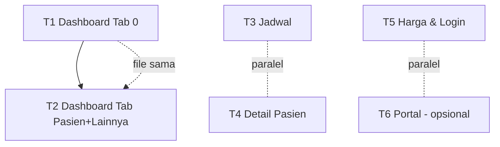

# Laporan Redesign IA — Sisi Profesional "Malva Mental Health"

> Arsitek: Bob (software-architect) · Stack: Flutter 3.44 + Riverpod + Material 3
> Tujuan user: **"Rapi & terstruktur"** — kurangi kepadatan visual, **tanpa menghilangkan satu pun fungsi**.
> Dokumen ini = kontrak untuk engineer & QA. Semua nama kelas/field/API **tidak berubah**.

---

## 0. Prinsip & Batasan yang Dipatuhi

- Redesign = ubah **susunan, pengelompokan, hierarki visual, kepadatan**. Bukan ubah kemampuan.
- Palet hanya dari `lib/src/theme.dart` (`MalvaColors`: seed `#8E44AD`, plum `#5D2E7E`, orchid `#B65ACB`, pink `#E58BE8`, mint `#36C7A6`, amber `#FFBE55`, danger `#E53935`, ink `#201B24`, paper `#FCFAFD`) + warna skema Material 3 yang sudah dipakai. **Tidak ada `Color(0x...)` baru.**
- Reuse komponen existing di `lib/src/widgets/malva_components.dart`: `SoftCard`, `SectionLabel`, `StatusPill`, `EmptyState`, `ProgressStrip`, `CollapsibleCard`, `MetricTile`, `ActionTile`, `GradientHeader` + `compactFilledButtonStyle`.
- **Tidak ada dependency pub baru.**
- **Tidak mengubah** nama kelas/field publik atau signature API (`MalvaApiClient`, model `Backend*`, provider). Semua edit bersifat internal (widget privat / susunan `children`).
- Konservatif sintaks: utamakan memindah/membungkus widget existing, hindari trik Dart tak lazim.

---

## 1. Inventaris Fungsi per Layar (KONTRAK QA — bukti tidak ada yang hilang)

### 1.1 `lib/src/screens/professional_dashboard_screen.dart` (2186 baris)

Header `GradientHeader` (selalu tampil):

| Elemen aksi | Handler / target | Efek |
|---|---|---|
| Indikator dot sync | `_SyncStatusIndicator` | Tooltip status sync (warna staleness) |
| Ikon Notifikasi | push `NotificationsScreen(session, apiClient)` | Buka notifikasi |
| Ikon Refresh manual | `_manualRefresh()` → `_syncService.refreshNow()` | Paksa sync |
| Ikon Keluar | `widget.onLogout` | Logout |

Tab **Dashboard (0)**:

| Elemen aksi | Handler | Efek |
|---|---|---|
| Banner status "Coba lagi" | `_loadOnlineProfessionalData` | Muat ulang data server |
| Metric "Pasien aktif" | `_showActivePatientsSheet` | Bottom-sheet daftar pasien aktif → tap → `_selectedPatientId=...; _tabIndex=1` |
| Metric "Crisis alert" | `_showPriorityListSheet(crisisOnly:true)` | Bottom-sheet antrean krisis |
| Metric "Perlu review" | `_showPriorityListSheet(crisisOnly:false)` | Bottom-sheet antrean review |
| Tombol "Refresh" (seksi) | `_loadOnlineProfessionalData` | Muat ulang |
| Tap kartu prioritas | `_showPriorityDetail(item)` | Bottom-sheet detail skor PHQ-9/GAD-7 |
| Tombol "Review"/"Lihat" kartu | `_openScreeningReview(patient, screening)` | Dialog review |
| Sheet detail: "Review screening" | `_openScreeningReview` | Dialog review |
| Sheet detail: "Tandai direview" | `_reviewScreening(id)` | Dialog note → `reviewScreening` API |
| Dialog review: "Tandai direview" | `_reviewScreening(id)` | `reviewScreening` API |

Tab **Pasien (2)**:

| Elemen aksi | Handler | Efek |
|---|---|---|
| Field search | `onChanged → _searchQuery` | Filter nama/ID/level |
| Tap baris pasien | push `ProPatientDetailScreen` lalu `.then(_loadOnlineProfessionalData)` | Buka detail pasien |

Tab **Lainnya (3)**:

| Elemen aksi | Handler | Efek |
|---|---|---|
| Seksi Relasi: "Sync" | `_loadOnlineProfessionalData` | Muat ulang relasi |
| Seksi Audit: "Export" | `_openExportSummary(selected)` | Dialog text + CSV |
| Dialog export: "Copy Data" | `_exportData()` → `SharePlus.instance.share(...)` | Bagikan CSV |
| ActionTile Katalog Harga | push `ProPricingScreen` | Harga |
| ActionTile Crisis Incident Log | push `CrisisIncidentLogScreen` | Log insiden |
| ActionTile E-Prescription | push `EPrescriptionScreen` | Resep elektronik |
| ActionTile Earnings | push `EarningsScreen` | Pendapatan |
| ActionTile Verifikasi STR/SIP | push `CredentialUploadScreen` | Upload kredensial |

Endpoint dipakai: `listPatientProfessionalLinks`, `listScreenings`, `listScreeningReviews`, `listProfessionalNotes`, `listAuditLogs`, `reviewScreening`.

> ⚠️ **Bug existing (JANGAN diubah tanpa persetujuan user):** `_showActivePatientsSheet` men-set `_tabIndex = 1` (tab Jadwal) padahal teks menyebut "buka detail di tab Pasien". Tab Pasien = indeks **2**. Catat untuk QA; perbaikan di luar scope density.

### 1.2 `lib/src/screens/pro_schedule_screen.dart` (1128 baris)

`ProScheduleScreen` (tab Jadwal) — 4 seksi:

| Elemen aksi | Handler | Efek |
|---|---|---|
| RefreshIndicator | `_load()` | Muat sesi + jadwal + harga |
| Seksi "Ketersediaan & harga" → "Atur" | `_openAvailability(context)` | push `ProAvailabilityScreen` |

`_ProSessionCard` (bila `!past && isScheduled`):

| Tombol | Handler | Efek |
|---|---|---|
| Join / Chat | `_openChat` | push `ChatScreen` |
| Detail pasien | `_openPatientDetail` | push `ProPatientDetailScreen` |
| Meeting (video+URL) | `_openMeeting` | `launchUrl` |
| Hadir | `_mark(...,'completed')` | `updateCareSession` |
| Tidak hadir | `_mark(...,'no_show')` | `updateCareSession` |
| Batal | `_cancel` | Dialog alasan → `updateCareSession('cancelled_by_professional')` |
| Reschedule | `_reschedule` | Dialog tanggal/jam → `rescheduleCareSession` |
| Link & ringkasan | `_editDetail` | Dialog → `updateCareSession(meetingUrl,summary,privateNote)` |
| "Buka detail pasien" (past) | `_openPatientDetail` | push detail |

`ProAvailabilityScreen` (dipush):

| Elemen aksi | Handler | Efek |
|---|---|---|
| "Nonaktifkan"/"Aktifkan" | `_toggleSchedule(s)` | `updateMySchedules` |
| "Hapus" | `_removeSchedule(s)` | `updateMySchedules` |
| "Tambah & Simpan" | `_addSchedule` | `updateMySchedules` |
| "Simpan harga" | `_savePricing` | `updatePricing` |

### 1.3 `lib/src/screens/pro_patient_detail_screen.dart` (1077 baris)

AppBar: "Chat sesi" → `ChatScreen`; "Muat ulang" → `_load`.

Seksi (11, semua terbuka): Paket & sesi · Screening (PHQ-9/GAD-7, `CollapsibleCard`) · Worksheet (`TherapySubmissionView`) · Hasil DASS-21/WHO-5 & tren (`_AssessmentTrendCard`) · Goals & habits · Mood & diary (read-only) · Kiriman pasien · Timeline pasien · Health record & obat · Catatan sesi.

| Elemen aksi | Handler | Efek |
|---|---|---|
| "Isi diagnosis" | `_openHealthRecordEdit` | Dialog → `updateHealthRecordDiagnosis` |
| "Resepkan obat" | `_openPrescribeMedication` | Dialog → `createMedication` |
| "Tulis catatan sesi" | `_openNote` | Dialog → `createProfessionalNote` |

Endpoint: `listCarePackages`, `listCareSessions`, `listScreenings`, `listTherapySubmissions`, `listGoals`, `listMoodCheckins`, `listDiaryEntries`, `listProfessionalNotes`, `listMedications`, `listTimeline`, `listMessages`, `getHealthRecord`.

### 1.4 `lib/src/screens/pro_pricing_screen.dart` (240 baris)

| Elemen aksi | Handler | Efek |
|---|---|---|
| 3 field harga | `_chatPrice`/`_videoPrice`/`_packagePrice` | Input |
| "Simpan harga" | `_save()` | `updatePricing` |

### 1.5 `lib/src/screens/professional_login_screen.dart` (315 baris)

| Elemen aksi | Handler | Efek |
|---|---|---|
| `AuthModeToggle` | `setState(_mode)` | Login ↔ Daftar |
| "Masuk"/"Daftar" | `_submit()` | `loginProfessionalOnline` / `registerProfessionalOnline` |
| `RememberForgotRow` | `showForgotPasswordDialog` | Remember + lupa password |

### 1.6 `lib/src/screens/portal/*` (3 file)

- `earnings_screen.dart`: field bank/rekening + "Request Payout" → `requestPayout`; daftar transaksi.
- `e_prescription_screen.dart`: FAB "Resep Baru" → form → `createEPrescription`; daftar & detail resep (QR/signature).
- `crisis_incident_log_screen.dart`: kartu insiden + "Mark Crisis Resolved" → `resolveCrisisIncident`.

---

## 2. Diagnosa Kepadatan (konkret)

| # | Lokasi | Masalah | Akar |
|---|---|---|---|
| D1 | Dashboard tab 0 | **9 blok vertikal dalam 1 scroll**: StatusBanner + SyncStatusBar + 3 MetricCard + SectionLabel + hingga 5 kartu prioritas (tiap kartu punya body + 2 chip + tombol) — semua muncul sekaligus di atas lipatan | Tidak ada prioritisasi; status & antrean tampil penuh |
| D2 | Header dashboard | **Duplikasi status sync**: `_SyncStatusIndicator` (dot) di header **dan** `_SyncStatusBar` (bar penuh) di body — dua representasi hal yang sama | Dua widget dibangun terpisah |
| D3 | Dashboard tab 3 | **3 seksi besar bertumpuk** (Relasi + Audit + Portal 5 ActionTile) = ~7 baris aksi + daftar pasien + daftar audit, semua terbuka | Tidak ada pengelompokan/lipatan |
| D4 | Jadwal (`_ProSessionCard`) | **Hingga 7 tombol dalam satu `Wrap`** per kartu sesi (Join, Detail, Meeting, Hadir, Tidak hadir, Batal, Reschedule, Link & ringkasan) | Aksi primer & sekunder setara |
| D5 | Jadwal | 4 seksi bertumpuk; `_AvailabilitySummary` (info referensi) setara bobotnya dengan "Sesi hari ini" | Tidak ada hierarki primer/sekunder |
| D6 | Detail pasien | **11 seksi terbuka dalam 1 scroll sangat panjang**; screening/worksheet sudah bisa dilipat, sisanya tidak | Hanya sebagian pakai `CollapsibleCard` |
| D7 | Umum | Kartu metrik vertikal (`_MetricCard`) + banner + bar menambah tinggi tanpa informasi baru di layar sempit | Komposisi vertikal tanpa kompresi |

---

## 3. IA Baru per Layar (before → after)

### 3.1 Dashboard — Tab Dashboard (0)

**BEFORE**
```
GradientHeader (dot sync + Notifikasi + Refresh + Keluar)
└─ ListView
   ├─ _StatusBanner (kondisional)
   ├─ _SyncStatusBar (kondisional)
   ├─ _PriorityMetrics  [Pasien aktif | Crisis alert | Perlu review]
   ├─ SectionLabel "Prioritas pasien" (+Refresh)
   └─ _PriorityQueue (≤5 kartu: header+body+2 chip+tombol)
```

**AFTER**
```
GradientHeader (dot sync + Notifikasi + Refresh + Keluar)   ← tetap
└─ ListView
   ├─ _DashboardStatusStrip      ← GABUNG _StatusBanner + _SyncStatusBar jadi 1 baris ringkas
   │     (prioritas tampil: error > syncing > last-sync; tombol "Coba lagi"/retry di dalamnya)
   ├─ SectionLabel "Ringkasan"
   ├─ _PriorityMetrics           ← tetap (3 kartu, tap → sheet seperti sekarang)
   ├─ SectionLabel "Prioritas pasien" (+Refresh)
   ├─ _PriorityQueue             ← batasi .take(3) (dari 5)
   └─ TextButton "Lihat semua prioritas" → _showPriorityListSheet(crisisOnly:false)
```
- **Fungsi hilang? Tidak.** Metric tap tetap buka sheet (yang menampilkan daftar penuh). Antrean penuh tetap tercapai lewat "Lihat semua prioritas" → sheet yang sudah ada.
- `_DashboardStatusStrip`: widget privat **baru** yang membungkus logika `_StatusBanner` + `_SyncStatusBar` (keduanya dipertahankan sebagai sub-bagian atau digabung; engine bebas memilih — lihat §5 T1). Tujuan: 1 baris, bukan 2 blok.

### 3.2 Dashboard — Tab Pasien (2)

**BEFORE**
```
_PatientSearch
SectionLabel "Pasien terhubung"
_ConnectedPatientList / EmptyState
```
**AFTER**
```
SectionLabel "Cari & filter pasien"     ← memberi hierarki
_PatientSearch
SectionLabel "Pasien terhubung (n)"     ← sertakan jumlah
_ConnectedPatientList / EmptyState      ← tetap
```
- Perubahan minimal, aman.

### 3.3 Dashboard — Tab Lainnya (3)

**BEFORE**
```
_RelationshipManagementSection (header+Sync, kode, daftar pasien)
_AuditAndExportSection (header+Export, daftar audit)
_ProfessionalPortalSection (header + 5 ActionTile)
```
**AFTER**
```
SectionLabel "Relasi & akses pasien"
└─ _RelationshipManagementSection   (daftar pasien → CollapsibleCard, default tertutup)

SectionLabel "Audit & ekspor"
└─ _AuditAndExportSection            (daftar audit → CollapsibleCard, default tertutup)

SectionLabel "Portal profesional"
├─ [sub] "Operasional"
│   ├─ ActionTile Katalog Harga
│   └─ ActionTile Earnings
└─ [sub] "Klinis & kepatuhan"
    ├─ ActionTile E-Prescription
    ├─ ActionTile Crisis Incident Log
    └─ ActionTile Verifikasi STR/SIP
```
- 5 ActionTile tetap semua; hanya dipecah 2 sub-grup berlabel. Daftar panjang (pasien/audit) dilipat.

### 3.4 Jadwal (`pro_schedule_screen.dart`)

**BEFORE**
```
SectionLabel "Sesi hari ini"     → _ProSessionCard (≤7 tombol Wrap)
SectionLabel "Mendatang"         → _ProSessionCard.take(10)
Row[SectionLabel "Ketersediaan & harga", "Atur"] → _AvailabilitySummary
SectionLabel "Riwayat sesi"      → _ProSessionCard.past.take(10)
```
**AFTER**
```
SectionLabel "Sesi hari ini"     → _ProSessionCard (aksi dibagi primer/sekunder)
SectionLabel "Mendatang"         → _ProSessionCard.take(10)
CollapsibleCard "Ketersediaan & harga"  (header: SectionLabel-ish + "Atur" tetap terlihat; isi _AvailabilitySummary, default tertutup)
SectionLabel "Riwayat sesi"      → _ProSessionCard.past.take(10)
```
`_ProSessionCard` — pembagian aksi (semua fungsi tetap ada):
```
Kartu sesi
├─ Header (avatar + nama + waktu + StatusPill)      ← selalu
├─ Ringkasan (bila ada)                             ← selalu
├─ AKSI PRIMER (Wrap): [Join / Chat] [Hadir] [Tidak hadir]
└─ CollapsibleCard "Aksi lain" (default tertutup):
     [Detail pasien] [Meeting] [Batal] [Reschedule] [Link & ringkasan]
```
- "Atur" (ketersediaan) tetap di area header kolapsibel agar selalu terlihat.
- Semua handler (`_openChat`, `_openPatientDetail`, `_openMeeting`, `_mark`, `_cancel`, `_reschedule`, `_editDetail`) tetap terpasang.

### 3.5 Detail Pasien (`pro_patient_detail_screen.dart`)

**BEFORE** — 11 seksi terbuka bertumpuk.

**AFTER** — 4 grup berlabel + lipatan untuk konten referensi:
```
GRUP "Ringkasan klinis"
├─ Paket & sesi            → CollapsibleCard (default tertutup; ringkas)
├─ Screening (PHQ-9/GAD-7) → CollapsibleCard per item (SUDAH ada, pertahankan)
├─ Worksheet dibagikan     → TherapySubmissionView (SUDAH kolapsibel)
└─ Hasil DASS-21/WHO-5 & tren → _AssessmentTrendCard (tetap)

GRUP "Pemantauan harian"   (semua read-only → CollapsibleCard, default tertutup)
├─ Goals & habits
├─ Mood & diary (read-only)
├─ Kiriman pasien
└─ Timeline pasien

GRUP "Rencana & catatan"
├─ Health record & obat    → tetap terbuka (punya tombol aksi)
└─ Catatan sesi            → tetap terbuka + "Tulis catatan sesi"

GRUP "Akses data"
└─ Banner restricted (bila ada)
```
- 11 seksi tetap ada; hanya dikelompokkan 4 grup + yang bersifat referensi dilipat.

### 3.6 Harga & Login & Portal (perubahan ringan)

- `pro_pricing_screen.dart`: bungkus 3 `_PriceField` di bawah `SectionLabel` yang sudah ada; tidak ada perubahan fungsi. (Sudah cukup rapi.)
- `professional_login_screen.dart`: beri sub-label grup pada mode Daftar → "Identitas" (Nama/STR/SIP/Spesialisasi), "Kontak" (Email/Telepon), "Keamanan" (Password/Konfirmasi). Field tetap sama.
- Portal (3 layar): sudah terstruktur; opsional beri `SectionLabel` grup. Prioritas rendah.

---

## 4. Sistem Visual yang Dipakai Ulang (aturan konsisten antar layar)

| Peran | Komponen | Kapan dipakai |
|---|---|---|
| Level 1 — Header grup | `SectionLabel(text, action?)` | Judul seksi/kategori. Aksi sekunder seksi (mis. Refresh/Sync/Export/Atur) ditaruh di `action`. |
| Level 2 — Kartu konten | `SoftCard` | Blok informasi tunggal, kartu list item ringkas. |
| Level 2 — Konten bisa dilipat | `CollapsibleCard(header, child, body?, initiallyExpanded=false)` | Daftar panjang / konten referensi (pasien, audit, worksheet, timeline, mood, riwayat). Header ringkas, detail tersembunyi. |
| Level 3 — Status | `StatusPill(label, color, icon?)` | Status sesi/paket/risiko/insiden. Warna dari `MalvaColors` sesuai makna. |
| Level 3 — Progres | `ProgressStrip(value, color)` | Kuota paket, skor PHQ-9/GAD-7. |
| Level 3 — Kosong | `EmptyState(icon, title, subtitle)` | Saat list kosong (pertahankan, jangan hapus). |
| Aksi list | `ActionTile` / `MetricTile` | Baris aksi portal / metrik. |
| Tombol dalam `Row` | `compactFilledButtonStyle` | Wajib — theme global full-width akan menjepit teks bila tanpa ini. |

**Aturan spasi & hierarki:**
- Padding layar: `EdgeInsets.all(18)` (konsisten dengan existing).
- Jarak antar grup besar: `22`; antar seksi: `14`; antar kartu dalam seksi: `8–10`; di dalam `SoftCard`: `16` (default) / `12–14` untuk kartu list.
- Warna makna tetap: krisis/severe → `danger`; sedang → `amber`; ringan/normal → `mint`; netral → `seed`/`onSurfaceVariant`.
- Tidak ada gradien baru selain `GradientHeader`.

**Kapan `SoftCard` vs `SectionLabel` vs `CollapsibleCard`:**
- `SectionLabel` **tidak** membungkus konten — hanya judul + aksi.
- `SoftCard` untuk konten yang **selalu ingin terlihat**.
- `CollapsibleCard` untuk konten yang **boleh tersembunyi sampai diminta** (default tertutup) → ini instrumen utama penurunan kepadatan.

---

## 5. Dekomposisi Tugas untuk Engineer

**Aturan aman:** tiap tugas = 1 file (kecuali T5/T6). Urutan menghindari konflik file. Hanya T1→T2 berurutan (file sama). T3/T4/T5/T6 paralel terhadap dashboard.

### T1 — Dashboard: Tab Dashboard (0) + strip status — P0
- **File:** `lib/src/screens/professional_dashboard_screen.dart`
- **Cakupan:** ganti cabang `if (_tabIndex == 0)` di `build()`; tambah widget privat `_DashboardStatusStrip` (bungkus/gabung logika `_StatusBanner` + `_SyncStatusBar` — jangan hapus dua kelas itu, tetap dipakai sebagai anak); ubah `_PriorityQueue` dari `.take(5)` → `.take(3)`; tambah `TextButton` "Lihat semua prioritas" → `_showPriorityListSheet(crisisOnly:false)`.
- **Jangan sentuh:** handler, dialog, `_loadOnlineProfessionalData`, sheet, `_MetricCard`/`_PriorityCard` internal.
- **Dep:** —
- **Risiko:** sedang (1 file besar, edit terlokalisasi).

### T2 — Dashboard: Tab Pasien (2) + Lainnya (3) — P0
- **File:** `lib/src/screens/professional_dashboard_screen.dart`
- **Cakupan:** tab 2 → tambah `SectionLabel` "Cari & filter pasien" & jumlah pada "Pasien terhubung"; tab 3 → pecah `_ProfessionalPortalSection` jadi 2 sub-grup berlabel "Operasional"/"Klinis & kepatuhan" (5 ActionTile tetap); bungkus daftar pasien `_RelationshipManagementSection` & daftar audit `_AuditAndExportSection` dengan `CollapsibleCard` default tertutup (header tetap menampilkan kode & tombol Sync/Export).
- **Dep:** T1 (file sama → kerjakan setelah T1 merge).
- **Risiko:** sedang.

### T3 — Jadwal: pembagian aksi kartu sesi + kolaps ketersediaan — P0
- **File:** `lib/src/screens/pro_schedule_screen.dart`
- **Cakupan:** di `_ProSessionCard`, pisahkan `Wrap` tombol jadi baris primer (Join/Chat, Hadir, Tidak hadir) + `CollapsibleCard` "Aksi lain" (Detail pasien, Meeting, Batal, Reschedule, Link & ringkasan); bungkus `_AvailabilitySummary` dalam `CollapsibleCard` (default tertutup) dengan tombol "Atur" tetap terlihat di area header.
- **Jangan ubah:** `_mark/_cancel/_reschedule/_editDetail/_openChat/_openPatientDetail/_openMeeting`, `ProAvailabilityScreen`.
- **Dep:** —
- **Risiko:** rendah–sedang.

### T4 — Detail Pasien: pengelompokan 11 seksi → 4 grup — P0
- **File:** `lib/src/screens/pro_patient_detail_screen.dart`
- **Cakupan:** sisipkan `SectionLabel` grup ("Ringkasan klinis", "Pemantauan harian", "Rencana & catatan", "Akses data"); bungkus Goals/Mood/Diary/Kiriman/Timeline dengan `CollapsibleCard` default tertutup; bungkus Paket & sesi dengan `CollapsibleCard`; pertahankan Screening/Worksheet `CollapsibleCard` & `TherapySubmissionView` yang sudah ada.
- **Jangan ubah:** `_openNote/_openPrescribeMedication/_openHealthRecordEdit`, `_AssessmentTrendCard`, `_ScreeningInstrumentDetail`.
- **Dep:** —
- **Risiko:** sedang (banyak seksi; jaga `...[]` spread agar delimiter seimbang).

### T5 — Harga & Login: sub-label grup — P1
- **File:** `lib/src/screens/pro_pricing_screen.dart`, `lib/src/screens/professional_login_screen.dart`
- **Cakupan:** pricing → pastikan 3 field di bawah `SectionLabel`; login → sub-label grup pada mode Daftar (Identitas/Kontak/Keamanan). Tidak ada perubahan field/handler.
- **Dep:** —
- **Risiko:** rendah.

### T6 — Portal: sub-label grup (opsional) — P2
- **File:** `lib/src/screens/portal/earnings_screen.dart`, `portal/e_prescription_screen.dart`, `portal/crisis_incident_log_screen.dart`
- **Cakupan:** tambah `SectionLabel` grup bila perlu; tidak ubah alur.
- **Dep:** —
- **Risiko:** rendah.

**Verifikasi statis (karena `flutter analyze/test` gagal di env ini — `CreateFile failed 231`):**
1. Cek keseimbangan delimiter (`{}`, `()`, `[]`) per file.
2. `dart format --output=none --set-exit-if-changed <file>` sebagai parse check (jika `dart` tersedia).
3. `grep` simbol yatim: pastikan tidak ada kelas privat yang ter-referensi tapi terhapus, dan sebaliknya.
4. Pastikan setiap handler dari §1 masih ter-referensi minimal sekali (grep nama method).

---

## 6. Required Packages

**Tidak ada paket pub baru.** Semua kebutuhan dipenuhi widget Material + komponen existing (`malva_components.dart`).

## 7. Shared Knowledge (untuk engineer)

- Format respons API: `{code, data, message}`; error dilempar sebagai `MalvaApiException(message, statusCode)`.
- Akses token dari `widget.session?.accessToken`; `null`/kosong = mode offline (tampilkan pesan, bukan crash).
- Pesan error user: `friendlyErrorMessage(e)`.
- Snackbar sukses → `MalvaColors.mint`; gagal → `MalvaColors.danger`.
- Semua `TextEditingController` **wajib** di-`dispose()`.
- Wajib `if (!mounted) return;` sebelum `setState` pasca-await.
- Warna hanya dari `MalvaColors` + skema M3. Dilarang `Color(0x...)` baru.
- Status `sync` memakai `SyncStatus { idle, syncing, error }`.

## 8. Graph Dependensi Tugas



## 9. Hal yang Belum Jelas / Asumsi

1. **Bug `_tabIndex = 1`** pada `_showActivePatientsSheet` (seharusnya 2). Tidak diperbaiki dalam scope ini — butuh konfirmasi user karena mengubah perilaku.
2. Overlap harga: `ProPricingScreen` dan `ProAvailabilityScreen` sama-sama mengedit harga. Keduanya **dipertahankan** (dua jalur masuk). Belum ada keputusan apakah salah satu nanti disatukan.
3. Batas `take(3)` pada `_PriorityQueue` diasumsikan aman karena daftar penuh tetap bisa diakses lewat sheet.
4. Verifikasi runtime tidak bisa dijalankan; engineer WAJIB melakukan cek statis §5 sebelum tandai selesai.
